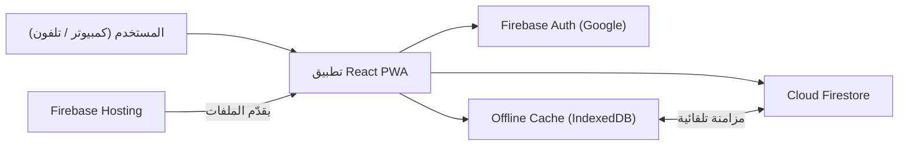
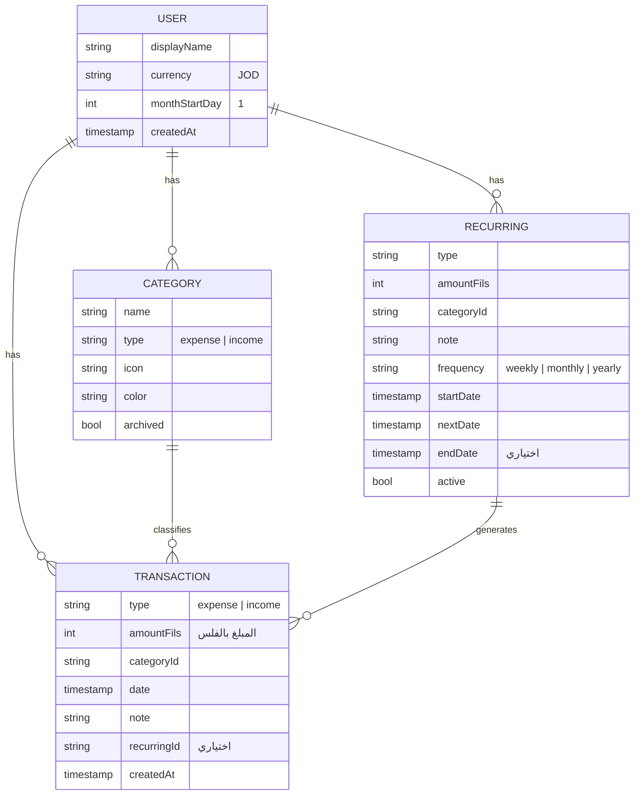
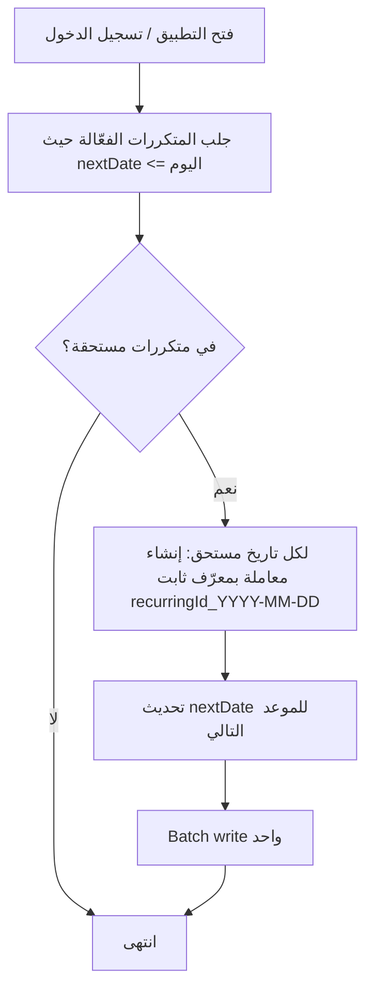
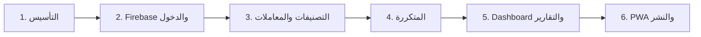

# خطة بناء موقع إدارة المصاريف الشخصية

## الهدف
بناء تطبيق ويب **عربي (RTL)** لإدارة المصاريف والمداخيل الشخصية بالدينار الأردني (JOD)، فيه:
- تسجيل المصاريف والمداخيل مع تصنيفات
- لوحة تحكم (Dashboard) مع رسوم بيانية
- تقارير شهرية وسنوية
- معاملات متكررة (راتب، إيجار، اشتراكات)

البيانات بتنحفظ على **Firebase** (سحابياً)، فبتقدر تفتح الموقع من الكمبيوتر أو التلفون وتشوف نفس البيانات. والموقع رح يكون **PWA**، يعني بتقدر تثبّته على شاشة التلفون الرئيسية وبيشتغل مثل التطبيق (وحتى بدون إنترنت، ويعمل مزامنة لما يرجع الاتصال).

---

## بحاجة لمراجعتك

> [!IMPORTANT]
> **حساب Firebase:** لازم يكون عندك حساب Google وتنشئ مشروع Firebase (مجاني، خطة Spark). أنا بقدر أعمله عن طريق الـ CLI بس لازم تعمل تسجيل دخول بنفسك (`firebase login`). **خلال التطوير رح أستخدم Firebase Emulator محلياً**، فبنقدر نبدأ ونجرّب كل شي قبل ما نحتاج المشروع الحقيقي.

> [!NOTE]
> **ليش PWA بدل تطبيق موبايل منفصل؟** نفس الكود بيشتغل على الكمبيوتر والتلفون، بيتثبّت من المتصفح، وبيشتغل offline. ولو بدك بعدين تطبيق حقيقي على المتجر، بنقدر نغلّفه بـ Capacitor بدون ما نعيد كتابته، وFirebase بيضل هو نفسه.

### القرارات التقنية

| الجزء | الاختيار | السبب |
|---|---|---|
| الواجهة | **React 19 + Vite + TypeScript** | سريع، منتشر، والأخطاء بتنكشف بدري بفضل TypeScript |
| التنسيق | **Tailwind CSS v4** | بيدعم RTL بشكل ممتاز (`ms-`/`me-`, `start`/`end`) |
| الخط | **Cairo** (Google Fonts) | خط عربي واضح للأرقام والنصوص |
| التنقل | **React Router** | |
| الرسوم البيانية | **Recharts** | بسيط ويدعم React |
| التواريخ | **date-fns** مع اللغة العربية | |
| تسجيل الدخول | **Firebase Auth – Google Sign-In** | أبسط وأأمن خيار، بدون كلمات سر |
| قاعدة البيانات | **Cloud Firestore (Standard، قاعدة `(default)`)** | مجانية ضمن الحصة، فيها offline persistence ومزامنة لحظية |
| الاستضافة | **Firebase Hosting** | مجاني، HTTPS تلقائي (ضروري للـ PWA) |
| PWA | **vite-plugin-pwa** | |
| الاختبارات | **Vitest** + **Firebase Emulator** لاختبار قواعد الأمان | |

---

## الأسئلة المفتوحة

> [!IMPORTANT]
> 1. **اسم التطبيق:** اقترح «مصاريفي». بدك اسم ثاني؟
> 2. **بداية الشهر المالي:** الافتراض إنه الشهر بيبدأ يوم 1. بعض الناس بيفضلوا يبدأ من يوم نزول الراتب (مثلاً يوم 25). بدك هالخيار بالإعدادات؟
> 3. **التصنيفات الافتراضية:** رح أجهّز تصنيفات جاهزة (بالأسفل) وبتقدر تعدّل عليها. في شي بدك تضيفه أو تشيله؟

**التصنيفات الافتراضية المقترحة:**
- **مصاريف:** طعام وبقالة 🛒، مطاعم ☕، مواصلات ووقود ⛽، إيجار وسكن 🏠، فواتير (كهرباء/مي/إنترنت) 💡، اتصالات 📱، صحة 💊، تسوق وملابس 👕، ترفيه 🎮، تعليم 📚، اشتراكات 🔁، عائلة وهدايا 🎁، أخرى ➕
- **مداخيل:** راتب 💼، عمل حر 💻، هدايا 🎁، استثمار 📈، أخرى ➕

---

## البنية العامة



### نموذج البيانات (Firestore)

كل بيانات المستخدم تحت المسار `users/{uid}`، وقواعد الأمان بتسمح **فقط** لصاحب الحساب يقرأ ويكتب بياناته.



> [!NOTE]
> **المبالغ بتنحفظ كأعداد صحيحة بالفلس** (1 دينار = 1000 فلس) لتجنب أخطاء الكسور العشرية (`0.1 + 0.2 ≠ 0.3`). العرض بيكون بصيغة `12.500 د.أ`.

### آلية المعاملات المتكررة

بدون Cloud Functions (لأنها بتحتاج خطة مدفوعة)، المعالجة بتصير **عند فتح التطبيق**:



المعرّف الثابت للمعاملة (`{recurringId}_{date}`) بيضمن **ما يتكرر تسجيل نفس المعاملة مرتين** حتى لو فتحت التطبيق على جهازين بنفس الوقت. ولو غبت 3 شهور، بتنضاف المعاملات الثلاث الفائتة دفعة وحدة.

---

## الصفحات

| الصفحة | المسار | المحتوى |
|---|---|---|
| تسجيل الدخول | `/login` | زر «الدخول بحساب Google» |
| لوحة التحكم | `/` | بطاقات: الرصيد/المداخيل/المصاريف لهذا الشهر، دائرة توزيع المصاريف حسب التصنيف، خط المصاريف اليومية، آخر 5 معاملات، المتكررات القادمة |
| المعاملات | `/transactions` | قائمة مجمّعة حسب اليوم، فلترة (الشهر، النوع، التصنيف، بحث بالملاحظة)، إضافة/تعديل/حذف |
| المتكررة | `/recurring` | قائمة المتكررات، إضافة/تعديل/إيقاف مؤقت/حذف، الموعد القادم |
| التقارير | `/reports` | تبويب شهري: مقارنة بالشهر السابق، أعلى التصنيفات. تبويب سنوي: أعمدة مداخيل/مصاريف لكل شهر، صافي الادخار، متوسط شهري |
| التصنيفات | `/categories` | إدارة التصنيفات (اسم، أيقونة، لون)، أرشفة بدل الحذف إذا عليها معاملات |
| الإعدادات | `/settings` | بداية الشهر المالي، تسجيل الخروج |

**التصميم:** على الكمبيوتر قائمة جانبية على اليمين، على التلفون شريط تنقل سفلي + زر عائم (+) لإضافة معاملة بسرعة. دعم الوضع الداكن تلقائياً حسب إعدادات الجهاز.

---

## التغييرات المقترحة (هيكل المشروع)

```
expenses1/
├── index.html                 # lang="ar" dir="rtl"
├── package.json
├── vite.config.ts             # + vite-plugin-pwa
├── tsconfig.json
├── firebase.json              # hosting + firestore + emulators
├── .firebaserc
├── firestore.rules
├── firestore.indexes.json
├── .env.example               # مفاتيح Firebase (VITE_FIREBASE_*)
├── public/
│   └── icons/                 # أيقونات PWA
├── tests/
│   └── firestore.rules.test.ts
└── src/
    ├── main.tsx
    ├── App.tsx                # الراوتر + حماية الصفحات
    ├── index.css              # Tailwind + خط Cairo
    ├── lib/
    │   ├── firebase.ts        # تهيئة Firebase + offline cache + emulator
    │   ├── money.ts           # تحويل فلس ↔ دينار والتنسيق
    │   ├── dates.ts           # حدود الشهر المالي، تنسيق عربي
    │   └── recurring.ts       # حساب التواريخ المستحقة (دوال نقية)
    ├── types/index.ts
    ├── services/              # كل التعامل مع Firestore
    │   ├── categories.ts
    │   ├── transactions.ts
    │   ├── recurring.ts
    │   └── seed.ts            # التصنيفات الافتراضية لأول دخول
    ├── hooks/                 # useAuth, useTransactions, useCategories ...
    ├── components/
    │   ├── layout/            # Sidebar, BottomNav, AppShell
    │   ├── ui/                # Button, Modal, Input, Card, EmptyState
    │   ├── TransactionForm.tsx
    │   ├── TransactionList.tsx
    │   ├── RecurringForm.tsx
    │   └── charts/            # CategoryPie, DailyLine, MonthlyBars
    └── pages/
        ├── LoginPage.tsx
        ├── DashboardPage.tsx
        ├── TransactionsPage.tsx
        ├── RecurringPage.tsx
        ├── ReportsPage.tsx
        ├── CategoriesPage.tsx
        └── SettingsPage.tsx
```

### أمثلة من الكود

**`src/lib/money.ts`**
```ts
export const toFils = (jod: string | number) => Math.round(Number(jod) * 1000);

const fmt = new Intl.NumberFormat('ar-JO', {
  style: 'currency', currency: 'JOD', minimumFractionDigits: 3,
});
export const formatJOD = (fils: number) => fmt.format(fils / 1000);
```

**`src/lib/recurring.ts`** (دالة نقية سهلة الاختبار)
```ts
export function dueDates(nextDate: Date, freq: Frequency, today: Date, endDate?: Date): Date[] {
  const out: Date[] = [];
  let d = nextDate;
  while (d <= today && (!endDate || d <= endDate)) {
    out.push(d);
    d = advance(d, freq); // addWeeks / addMonths / addYears مع معالجة نهاية الشهر (31 → 28/30)
  }
  return out;
}
```

**قواعد الأمان (`firestore.rules`)** — رح تنكتب عن طريق الوكيل المتخصص `firestore-rules-author`، والمبدأ:
- كل مستخدم بيوصل بس لـ `users/{uid}/**` حيث `uid == request.auth.uid`
- التحقق من الحقول والأنواع (`amountFils` عدد صحيح موجب، `type` من القيم المسموحة، إلخ)
- منع أي وصول ثاني

---

## مراحل التنفيذ



1. **التأسيس:** إنشاء مشروع Vite + TS، Tailwind، خط Cairo، RTL، الهيكل العام (Sidebar / BottomNav).
2. **Firebase والدخول:** تهيئة Firebase مع Emulator، تسجيل الدخول بـ Google، حماية الصفحات، إنشاء التصنيفات الافتراضية أول مرة، قواعد الأمان.
3. **التصنيفات والمعاملات:** CRUD كامل، فلترة وبحث، نموذج إضافة سريع.
4. **المتكررة:** CRUD + منطق التوليد التلقائي + اختبارات.
5. **Dashboard والتقارير:** البطاقات والرسوم البيانية والتقارير الشهرية والسنوية.
6. **PWA والنشر:** manifest وأيقونات وservice worker، إنشاء مشروع Firebase الحقيقي (بعد تسجيل دخولك)، النشر على Firebase Hosting.

---

## خطة التحقق

### اختبارات تلقائية
```powershell
npm run typecheck        # tsc --noEmit
npm run test             # Vitest: money.ts, dates.ts, recurring.ts
npm run test:rules       # firebase emulators:exec "vitest run tests/firestore.rules.test.ts"
npm run build            # التأكد إن البناء بينجح
```
- **وحدات:** تحويل المبالغ وتنسيقها، حدود الشهر المالي، توليد التواريخ المتكررة (أسبوعي/شهري/سنوي، نهاية الشهر، تاريخ الانتهاء، فترات غياب طويلة).
- **قواعد الأمان:** مستخدم ما بيقدر يقرأ/يكتب بيانات مستخدم ثاني، رفض غير المسجلين، رفض البيانات غير الصالحة.

### تحقق يدوي (بالمتصفح مع Emulator)
- تسجيل الدخول → ظهور التصنيفات الافتراضية
- إضافة/تعديل/حذف معاملة → تحديث الـ Dashboard لحظياً
- إنشاء معاملة متكررة بتاريخ قديم → توليد المعاملات الفائتة بدون تكرار عند إعادة التحميل
- التقارير الشهرية والسنوية بأرقام صحيحة
- عرض التلفون (DevTools responsive) وسلامة الـ RTL
- Lighthouse: التطبيق قابل للتثبيت كـ PWA
- بعد النشر: فتح الرابط من تلفونك وتثبيته على الشاشة الرئيسية
