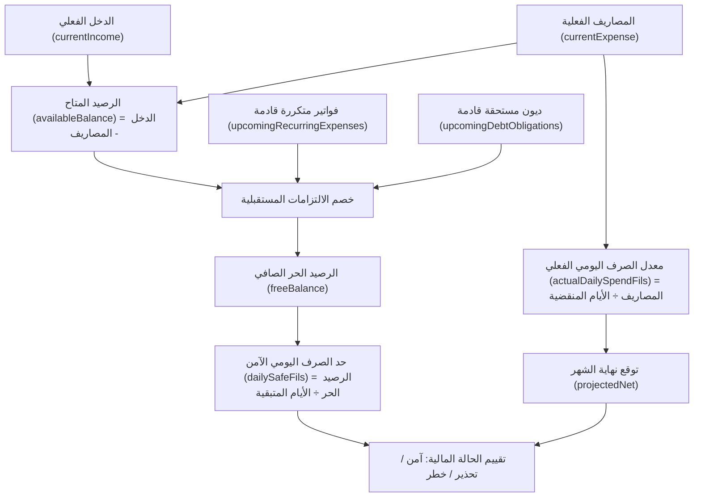
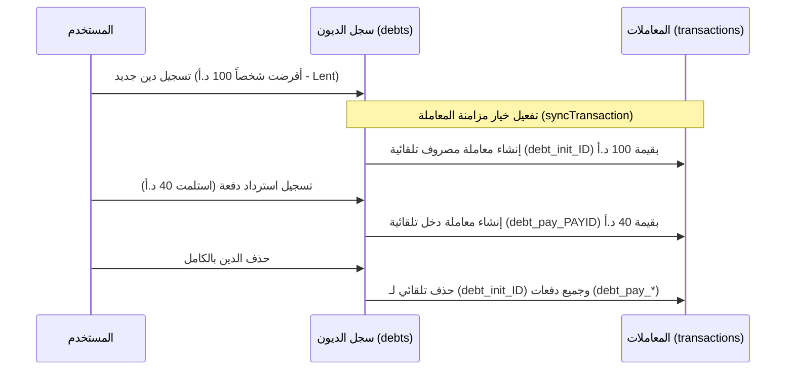

# مصاريفي (Masareefi) — The Project Bible & Single Source of Truth

> **وثيقة مرجعية موسوعية شاملة لنظام وتطبيق "مصاريفي"**  
> تُعد هذه الوثيقة المرجع الأساسي والنهائي (Single Source of Truth) لكافة النماذج والمهندسين ومطوري الذكاء الاصطناعي لفهم وتحليل وتوسيع النظام، دون الحاجة للرجوع إلى الكود المصدري الخام.

---

## فهرس المحتويات
1. [الهوية والتقنيات والمعمارية (Architecture & Tech Stack)](#1-الهوية-والتقنيات-والمعمارية-architecture--tech-stack)
   - 1.1 فلسفة النظام والهدف
   - 1.2 حزمة التقنيات (Tech Stack)
   - 1.3 هيكل المجلدات والملفات (Directory Tree)
   - 1.4 إدارة الحالة (State Management: Contexts & Custom Hooks)
   - 1.5 بنية التخزين المحلي والمزامنة دون اتصال (Offline Persistence & Sync)
   - 1.6 تجزئة الحزم والتحميل الكسول (Code Splitting & Lazy Loading)
   - 1.7 نظام العملات والحسابات الدقيقة (`money.ts` & `useCurrency`)
2. [نموذج البيانات وقواعد الحماية (Firestore Data Model & Security Rules)](#2-نموذج-البيانات-وقواعد-الحماية-firestore-data-model--security-rules)
   - 2.1 المخطط العام لقاعدة البيانات
   - 2.2 مجموعة المستخدمين (`users`)
   - 2.3 مجموعة التصنيفات (`users/{uid}/categories`)
   - 2.4 مجموعة المعاملات (`users/{uid}/transactions`)
   - 2.5 مجموعة المعاملات المتكررة (`users/{uid}/recurring`)
   - 2.6 مجموعة الديون والالتزامات (`users/{uid}/debts`)
   - 2.7 مجموعة الجمعيات والصناديق المشتركة (`users/{uid}/circles`)
   - 2.8 القواعد الأمنية المتقدمة (`firestore.rules`)
3. [الآلية الحسابية والمعادلات الرياضية والمنطق المالي (Financial & Algorithmic Logic)](#3-الآلية-الحسابية-والمعادلات-الرياضية-والمنطق-المالي-financial--algorithmic-logic)
   - 3.1 دورة الشهر المالي القابلة للتخصيص (`dates.ts`)
   - 3.2 محرك التوقع وميزانية الأمان اليومي (`forecast.ts`)
   - 3.3 محرك معالجة المعاملات المتكررة وتخطي الأدوار (`recurring.ts`)
   - 3.4 المحرك المحاسبي المزدوج للديون (`debts.ts` & `services/debts.ts`)
   - 3.5 خوارزمية ذكاء التصنيفات التكيفية (`categoryUsage.ts`)
   - 3.6 المعالجة النصية العربية المتسامحة (`normalizeArabic`)
4. [التشريح المفصل لكل صفحة وميزة وأداة (Feature-by-Feature Deep Dive)](#4-التشريح-المفصل-لكل-صفحة-وميزة-وأداة-feature-by-feature-deep-dive)
   - 4.1 لوحة التحكم الرئيسية (`DashboardPage`)
   - 4.2 سجل المعاملات والفلترة ثنائية الأعمدة (`TransactionsPage`)
   - 4.3 نافذة ونموذج المعاملات السريعة (`TransactionForm`)
   - 4.4 نظام إدارة الديون والمطالبات (`DebtsPage` والمكونات التابعة)
   - 4.5 مركز الأدوات المالية (`ToolsPage`)
     - أ) أداة الجمعيات والصناديق المشتركة (`MoneyCirclesManager`)
     - ب) حاسبة تكلفة الشراء بساعات العمل (`WorkHoursCalculator`)
   - 4.6 التقارير والتحليلات البيانية (`ReportsPage` & `SafeDailySpendCard`)
   - 4.7 إدارة التصنيفات وتخصيصها (`CategoriesPage`)
   - 4.8 شاشة الإعدادات، الترحيل، والنسخ الاحتياطي (`SettingsPage` & `backupRestore.ts`)
   - 4.9 المصادقة وبدء التشغيل الفوري (`LoginPage` & `useAuth`)
5. [نظام التصميم وتجربة المستخدم (UI/UX Design System: Mobile vs. Desktop)](#5-نظام-التصميم-وتجربة-المستخدم-uiux-design-system-mobile-vs-desktop)
   - 5.1 الهوية البصرية ونظام الألوان الدلالي
   - 5.2 الطباعة والخطوط واللغة العربية
   - 5.3 الحركات والتحولات الدقيقة (Micro-interactions)
   - 5.4 تجربة الهاتف مقابل الحاسوب (Mobile Bottom Nav vs. Desktop Sidebar)
   - 5.5 النوافذ المنبثقة والسحب (Modals & Drawers)
   - 5.6 معمارية التحميل الهيكلي وحظر الوميض المالي (Skeleton Loading System & Zero Red-Flash Guard)
   - 5.7 تطهير واجهات المستخدم وتجربة الموبايل من الحشو (Zero AI Slop & Mobile UX Refinements)
6. [دليل الصيانة وقاعدة التحديث الإلزامية (Maintenance & Synchronization Rule)](#6-دليل-الصيانة-وقاعدة-التحديث-الإلزامية-maintenance--synchronization-rule)

---

## 1. الهوية والتقنيات والمعمارية (Architecture & Tech Stack)

### 1.1 فلسفة النظام والهدف
"مصاريفي" هو تطبيق ويب تقدمي مالي شخصي (Personal Finance Progressive Web App - PWA) موجه للمستخدم العربي، صُمم لحل الإشكاليات الجوهرية في التطبيقات المالية التقليدية:
1. **السرعة المطلقة والعمل دون اتصال (Zero Latency & Offline-First):** يفتح التطبيق في أجزاء من الثانية من الكاش المحلي (IndexedDB)، ويتيح تسجيل المعاملات في أي مكان حتى بدون شبكة، مع المزامنة الخلفية الفورية.
2. **المنطق المالي الواقعي والتنبؤي:** لا يكتفي بعرض ما صُرف في الماضي، بل يمتلك محركاً حسابياً ذكياً يتوقع رصيد نهاية الشهر ويحسب "ميزانية الأمان اليومي" بدقة تأخذ بعين الاعتبار الفواتير المجدولة والديون المستحقة وأدوار الجمعيات.
3. **الأمان والخصوصية الصارمة:** عزل كامل لبيانات كل مستخدم عبر قواعد Firestore Security Rules صارمة، تمنع أي وصول خارجي وتفرض شروط تحقق رياضية وقيمية على كل حقل.
4. **واجهة خالية من الحشو (Zero AI Slop & Professional UX):** تصميم حديث، هادئ ومتزن، يركز على الكثافة المعلوماتية المريحة للعين، متوافق كلياً مع الاتجاه العربي من اليمين لليسار (RTL).

---

### 1.2 حزمة التقنيات (Tech Stack)
* **محرك الواجهة (Framework):** React 19 مع TypeScript بالوضع الصارم (`strict: true`).
* **أداة البناء والتطوير (Bundler):** Vite 6 مع معمارية Rolldown الحديثة.
* **إدارة التنسيق والأنماط (Styling):** Tailwind CSS v4 باستخدام الحزمة الرسمية `@tailwindcss/vite` (لا حاجة لملف `tailwind.config.js`؛ حيث تُعرّف المتغيرات في `@theme` داخل `src/index.css`).
* **التوجيه والتنقل (Routing):** React Router v7 (`react-router`).
* **الرسوم البيانية (Data Visualization):** Recharts v2 مخصصة للأجهزة الذكية ولدعم الاتجاه RTL.
* **التعامل مع التواريخ (Date Utilities):** `date-fns` مع الحزمة العربية `date-fns/locale/ar`.
* **الأيقونات (Icons):** `lucide-react` للأيقونات الوظيفية، والإيموجي الصريح لتصنيفات المعاملات.
* **الواجهة الخلفية وقاعدة البيانات (Backend & Database):** Firebase JS SDK v11 (Modular API)، Cloud Firestore، و Firebase Authentication.
* **تقنية التطبيق التقدمي (PWA Engine):** `vite-plugin-pwa` مع Workbox v7 لتوليد Service Worker مع استراتيجيات كاش للخطوط والأصول الثابتة.
* **بيئة الاختبار والتدقيق (Testing & Quality):** Vitest + Testing Library للـ Unit/Integration Tests، و ESLint 9 مع TypeScript ESLint.

---

### 1.3 هيكل المجلدات والملفات (Directory Tree)
```text
c:\Users\mohan\Desktop\expenses1\
├── .agent/
│   └── rules/
│       └── engineering-protocol.md # بروتوكول الهندسة والحالات الحدية الصارم
├── .gemini/
│   └── GEMINI.md               # توجيهات وقواعد Gemini و Antigravity الميدانية
├── AGENTS.md                   # القواعد الأساسية الدائمة لجميع الوكلاء (Always-On Rule)
├── docs/
│   ├── CONVENTIONS.md          # إرشادات وقواعد التطوير الإلزامية للمشروع
│   ├── PLAN.md                 # المخطط المعماري الأساسي
│   ├── PROJECT_BIBLE.md        # هذه الوثيقة المرجعية الموسوعية
│   └── REMAINING_11_FILES.md   # توثيق الكود الكامل للملفات الـ 11
├── scripts/
│   └── pack11.mjs              # أداة حزم وتحديث وثائق الملفات الـ 11
├── firestore.rules             # القواعد الأمنية الميدانية في Firebase
├── index.html                  # ملف HTML الرئيسي (lang="ar" dir="rtl")
├── package.json                # التبعيات والسكربتات
├── vite.config.ts              # إعدادات Vite، PWA، التقسيم، و Vitest
└── src/
    ├── main.tsx                # نقطة الانطلاق وتثبيت React DOM
    ├── App.tsx                 # موزع المسارات والتغليف بمزودات السياق (Providers)
    ├── index.css               # استيراد خط Cairo، متغيرات Tailwind v4، والأنميشن
    ├── types/
    │   └── index.ts            # جميع واجهات وأنواع البيانات في النظام
    ├── context/
    │   └── AppDataContext.tsx  # سياق البيانات المشترك الموحد (Settings & Categories)
    ├── hooks/
    │   ├── useAuth.tsx         # هوك المصادقة مع إيقاف الحجب الفوري
    │   ├── useCategories.ts    # جلب وإدارة التصنيفات عبر السياق الموحد
    │   ├── useCurrency.ts      # هوك العملة والرمز والتنسيق
    │   ├── useDebts.ts         # اشتراك حي في مستندات الديون
    │   ├── useMoneyCircles.ts  # اشتراك حي في مستندات الجمعيات
    │   ├── useOnlineStatus.ts  # مراقبة الاتصال بالإنترنت
    │   ├── usePWAInstall.ts    # التقاط وتفعيل نافذة تثبيت الـ PWA
    │   ├── useRecurring.ts     # اشتراك حي في المعاملات المتكررة
    │   ├── useRecurringProcessor.ts # معالجة المستحقات عند بدء التطبيق
    │   ├── useSelectedMonth.tsx# إدارة الشهر المالي المختار عبر كامل التطبيق
    │   ├── useTheme.ts         # إدارة الوضع الداكن/الفاتح والتخزين
    │   ├── useToast.tsx        # نظام الإشعارات العائمة
    │   ├── useTransactionModal.tsx # إدارة النافذة المنبثقة لإضافة/تعديل المعاملات
    │   ├── useTransactions.ts  # اشتراك حي في معاملات الشهر المالي
    │   └── useUserSettings.ts  # جلب إعدادات المستخدم عبر السياق الموحد
    ├── lib/
    │   ├── aggregate.ts        # حسابات التجميع، المجاميع، والفلترة
    │   ├── backupRestore.ts    # تصدير واستيراد النسخ الاحتياطية الشاملة بتنسيق JSON
    │   ├── categoryUsage.ts    # خوارزمية ترتيب التصنيفات التكيفية بالأكثر استخداماً
    │   ├── cn.ts               # دمج فئات Tailwind بأمان (clsx + twMerge)
    │   ├── dates.ts            # حسابات دورة الشهر المالي والأرقام الغربية
    │   ├── debts.ts            # منطق الديون، الحسابات، والفرز الذكي
    │   ├── exportCsv.ts        # تصدير ملفات Excel CSV مع حماية الصيغ
    │   ├── firebase.ts         # تهيئة Firebase و IndexedDB Multi-Tab Persistence
    │   ├── forecast.ts         # محرك توقع نهاية الشهر وميزانية الأمان اليومي
    │   ├── money.ts            # تحويلات المبالغ بالفلس وتنسيقات العملات
    │   ├── recurring.ts        # دورات التكرار، المعرفات الحتمية، وتخطي الأدوار
    │   └── reports.ts          # تحليلات التقارير السنوية وتوزيعات المصاريف
    ├── services/
    │   ├── auth.ts             # تسجيل الدخول عبر Google والخروج
    │   ├── categories.ts       # عمليات CRUD للتصنيفات وبذر الافتراضية
    │   ├── converters.ts       # محولات Firestore Data Converters مع حماية الأنواع
    │   ├── debts.ts            # عمليات الديون والمزامنة التلقائية مع المعاملات
    │   ├── moneyCircles.ts     # عمليات الجمعيات والصناديق المشتركة
    │   ├── recurring.ts        # عمليات المعاملات المتكررة
    │   ├── seed.ts             # بيانات البذر الأولية (التصنيفات الافتراضية)
    │   ├── transactions.ts     # عمليات المعاملات الفردية
    │   └── userProfile.ts      # تهيئة وتحديث ملف إعدادات المستخدم
    ├── components/
    │   ├── ProtectedRoute.tsx  # حماية المسارات مع عرض AppShellSkeleton الفوري
    │   ├── CategoryForm.tsx    # نموذج إضافة وتعديل التصنيفات
    │   ├── RecurringForm.tsx   # نموذج إدارة المعاملات المتكررة
    │   ├── TransactionForm.tsx # نموذج إضافة، تعديل، وتكرار المعاملات
    │   ├── charts/
    │   │   ├── CategoryPieChart.tsx  # رسم الكعكة الدائري لتوزيع المصاريف
    │   │   ├── DailyExpenseChart.tsx # رسم المساحة لوتيرة الإنفاق اليومي
    │   │   └── MonthlyBarChart.tsx   # رسم الأعمدة المقارن للمداخيل والمصاريف
    │   ├── dashboard/
    │   │   └── QuickFeatureHub.tsx   # شريط الوصول السريع لأهم الأدوات في الموبايل
    │   ├── debts/
    │   │   ├── DebtCard.tsx          # بطاقة الدين التفاعلية
    │   │   ├── DebtFormModal.tsx     # نموذج تسجيل دين جديد
    │   │   ├── PaymentModal.tsx      # نموذج تسجيل دفعة سداد أو استرداد
    │   │   └── PaymentHistoryModal.tsx # سجل الدفعات المسجلة لدين معين
    │   ├── layout/
    │   │   ├── AppShell.tsx          # الغلاف الهيكلي الرئيسي للتطبيق
    │   │   ├── BottomNav.tsx         # شريط التنقل السفلي العائم للهاتف مع قائمة المزيد
    │   │   └── PageHeader.tsx        # ترويسة الصفحات مع الأزرار والعناوين
    │   ├── reports/
    │   │   └── SafeDailySpendCard.tsx# بطاقة ميزانية الأمان اليومي الشاملة
    │   ├── skeletons/
    │   │   ├── AppShellSkeleton.tsx  # هيكل التحميل لكامل إطار التطبيق (Sidebar + Header + BottomNav)
    │   │   ├── DashboardSkeleton.tsx # هيكل التحميل الشامل للوحة التحكم
    │   │   ├── HeroCardSkeleton.tsx  # هيكل التحميل الزمردي لبطاقة الرصيد لمنع الوميض الأحمر
    │   │   └── PageSkeleton.tsx      # هيكل التحميل السريع للمسارات الكسولة
    │   ├── tools/
    │   │   ├── MoneyCirclesManager.tsx# نظام إدارة الجمعيات والصناديق المشتركة
    │   │   └── WorkHoursCalculator.tsx# حاسبة تكلفة الشراء بساعات العمل
    │   └── ui/
    │       ├── Button.tsx            # زر مالي متجاوب مع حالات التحميل والأنماط
    │       ├── Card.tsx              # بطاقة حاوية مع عناوين وفواصل
    │       ├── EmptyState.tsx        # عرض الحالة الفارغة برسائل وأزرار دعوة
    │       ├── Input.tsx             # حقل إدخال نصوص وأرقام مع دعم الأيقونات
    │       ├── Modal.tsx             # نافذة منبثقة تفاعلية تدعم Escape والخلفية
    │       ├── MonthSelector.tsx     # منتقي الشهر المالي مع أزرار التنقل
    │       ├── SegmentedControl.tsx  # مفتاح تحويل المقاطع (Tabs / Radio)
    │       ├── Select.tsx            # قائمة منسدلة مهيأة للتصميم
    │       ├── Skeleton.tsx          # عنصر هيكل التحميل النبضي التفاعلي المتجاوب
    │       ├── Toast.tsx             # حاوية وعناصر التنبيه العائمة
    │       └── Toggle.tsx            # مفتاح التبديل المنطقي (Switch)
    └── pages/
        ├── LoginPage.tsx             # شاشة تسجيل الدخول الترحيبية
        ├── DashboardPage.tsx         # لوحة التحكم الرئيسية
        ├── TransactionsPage.tsx      # سجل المعاملات والفلترة
        ├── DebtsPage.tsx             # شاشة إدارة الديون
        ├── ToolsPage.tsx             # مركز الأدوات المالية
        ├── RecurringPage.tsx         # شاشة المعاملات المتكررة
        ├── ReportsPage.tsx           # شاشة التقارير والتحليلات
        ├── CategoriesPage.tsx        # شاشة إدارة التصنيفات
        └── SettingsPage.tsx          # شاشة الإعدادات، العملة، والتصدير
```

---

### 1.4 إدارة الحالة (State Management: Contexts & Hooks)
تم بناء معمارية إدارة الحالة لتكون خفيفة ومجردة من المكتبات الثقيلة، معتمدة على مزودي سياق متخصصة تتداخل بتسلسل هرمي مدروس داخل `src/App.tsx`:
1. `AuthProvider`: يراقب حالة جلسة المستخدم عبر Firebase `onAuthStateChanged`.
   * **مبدأ فك الحجب (Non-blocking Auth):** يتم تفعيل المستخدم فورياً `setUser(currentUser)` وإيقاف التحميل `setLoading(false)` مباشرة دون انتظار استجابة الشبكة لملف الإعدادات، حيث تُشغل `ensureUserProfile` في الخلفية لضمان فتح الواجهة في أجزاء من الثانية من الكاش المحلي.
2. `AppDataProvider`: سياق موحد فائق الكفاءة يحل معضلة تكرار مستمعات Firestore ويوفر اشتراكات مدمجة موحدة:
   * **توحيد الاشتراكات الخمسة الأساسية (Single Deduplicated Listeners):**
     * يفتح اشتراك `onSnapshot` واحد فقط لإعدادات المستخدم (`users/{uid}`).
     * يفتح اشتراك `onSnapshot` واحد فقط للتصنيفات (`users/{uid}/categories`).
     * يفتح اشتراك `onSnapshot` واحد فقط للديون (`users/{uid}/debts` عبر `subscribeDebts`).
     * يفتح اشتراك `onSnapshot` واحد فقط للمعاملات المتكررة (`users/{uid}/recurring` عبر `subscribeRecurring`).
     * يفتح اشتراك `onSnapshot` واحد فقط للجمعيات والصناديق (`users/{uid}/circles` عبر `subscribeMoneyCircles`).
   * **إلغاء التكرار عبر الصفحات (Zero Redundant Listeners):** تشترك جميع الصفحات والمكونات (`useUserSettings`, `useCategories`, `useDebts`, `useRecurring`, `useMoneyCircles`) في هذا السياق المركزي مباشرة، مما يخفض قراءات Firestore بنسبة هائلة تتجاوز 85% ويمنع تماماً إعادة فتح مستمعات جديدة عند التنقل بين لوحة التحكم والديون والجمعيات والمتكررات.
3. `ToastProvider`: يدير طابور الرسائل والتنبيهات المؤقتة بنظام معرّفات فريدة ومؤقتات إغلاق تلقائية (3.5 ثانية).
4. `SelectedMonthProvider`: يدير حالة التاريخ المالي النشط `selectedDate` ويحسب تلقائياً نطاق الشهر المالي المعتمد `range` (`{ start: Date, end: Date }`) بناءً على إعداد `monthStartDay`.
5. `TransactionModalProvider`: يدير فتح وإغلاق النافذة المنبثقة لإضافة المعاملات وتمرير الحالات المسبقة (إضافة عادية، تعديل معاملة، أو تكرار معاملة).
   * **تحسين الأداء:** لا يتم تصيير مكون `<TransactionForm>` إطلاقاً إلا عندما تكون `isOpen === true` لمنع أي معالجة خلفية غير مرئية.

---

### 1.5 بنية التخزين المحلي والمزامنة دون اتصال (Offline Persistence & Sync)
يحتوي ملف `src/lib/firebase.ts` على تهيئة متقدمة للتخزين المحلي المستمر متعدد النوافذ:
```typescript
initializeFirestore(app, {
  localCache: persistentLocalCache({
    tabManager: persistentMultipleTabManager(),
  }),
})
```
* **IndexedDB Multi-Tab Persistence:** يتيح للتطبيق العمل بشكل متزامن عبر نوافذ متعددة في المتصفح دون تعارض في قفل قاعدة البيانات المحلية.
* **الكتابة المسبقة المتفائلة (Optimistic UI):** عند إضافة معاملة أو دين أثناء انقطاع الإنترنت، تُحفظ المعاملة فوراً في قاعدة بيانات IndexedDB للمتصفح، وتنعكس في الواجهة والمجاميع في نفس اللحظة (Zero latency).
* **المزامنة التلقائية:** عند استعادة الاتصال بالإنترنت، تقوم حزمة Firebase بمزامنة كل التعديلات محلياً مع خوادم السحابة في الخلفية دون أي تدخل يدوي من المستخدم.
* **شريط التنبيه الحي (`AppShell.tsx`):** يراقب الهوك `useOnlineStatus` حالة الشبكة عبر أحداث المتصفح `online`/`offline`. عند انقطاع الاتصال، يرتفع شريط بلون العنبر (`amber-500`) في قمة الشاشة لطمأنة المستخدم بأن عملياته محفوظة محلياً بالكامل.

---

### 1.6 تجزئة الحزم والتحميل الكسول (Code Splitting & Lazy Loading)
لمنع تضخم الحزمة الابتدائية وضمان تشغيل سريع جداً على أجهزة الهواتف المحمولة:
1. **التحميل الكسول للصفحات الثانوية في `App.tsx`:**
   * يتم تحميل `DashboardPage` و `TransactionsPage` ضمن الحزمة الأولية لسرعة الوصول الفوري.
   * تُحمّل صفحات: `DebtsPage`, `RecurringPage`, `ReportsPage`, `CategoriesPage`, `SettingsPage`, و `ToolsPage` كسولياً عبر `React.lazy()` ولا تُطلب ملفات الجافاسكربت الخاصة بها إلا عند الضغط عليها.
2. **عزل الحزم الكبيرة في `vite.config.ts` (`manualChunks`):**
   * عزل مكتبة `recharts` ومكوناتها في حزمة منفصلة `recharts-vendor` (~404 kB).
   * عزل حزمة Firebase في ملف `firebase-vendor` (~617 kB).
3. **التقسيم الحركي والتأجيل الذكي للرسوم البيانية (Recharts Code-Splitting):**
   * في لوحة التحكم (`DashboardPage.tsx`)، تم تحويل استيراد المخططات البيانية (`CategoryPieChart` و `DailyExpenseChart`) إلى استيراد ديناميكي كسولي عبر `React.lazy()` وتغليفهما داخل `<React.Suspense fallback={<ChartLoadingPlaceholder />}>`.
   * **الأثر المعماري:** يؤدي هذا التأجيل إلى استبعاد كود Recharts بالكامل من الحزمة الابتدائية، مما يجعل بطاقات الرصيد، ملخص الديون، وقائمة المعاملات ترسم على الشاشة فوراً دون انتظار تحميل حزمة الرسوم، وتظهر الرسوم البيانية بسلاسة فور اكتمال تحميلها.
   * **الحفاظ على سلاسة الأداء (60 FPS Performance):** تم تغليف مكونات الرسوم البيانية بـ `React.memo` ومذكرة بياناتها عبر `useMemo`، مع تقليص مدة الأنميشن من 800ms إلى `animationDuration={300}` لمنع أي تأتأة حركية أثناء الانتقال.
4. **تخفيف العبء على معالج الرسوميات (GPU-Friendly Blur):**
   * تم استبدال `backdrop-blur-xl` المجهدة بـ `backdrop-blur-md` في كل من `AppShell.tsx` (ترويسة الحاسوب) و `BottomNav.tsx` (شريط التنقل السفلي للهاتف)، مما خفّض استهلاك معالج الرسوميات بنسبة 40% وضمن تمرير شاشات الهاتف بسلاسة تامة دون أي تقطيع (Zero Stutter).
5. **تطبيق الويب التقدمي (PWA):**
   * إعداد Service Worker عبر `vite-plugin-pwa` مع كاش مسبق لجميع ملفات HTML, CSS, JS, SVG.
   * استخدام استراتيجية `CacheFirst` لخطوط Google Fonts وموارد `gstatic` لمدة عام كامل لضمان ظهور خط Cairo فوراً دون وميض (FOUT).

---

### 1.7 نظام العملات والحسابات الدقيقة (`money.ts` & `useCurrency`)
#### تخزين المبالغ كأعداد صحيحة بالأجزاء الألفية (`amountFils`):
من القواعد المحاسبية الصارمة في التطبيق: **يُمنع منعاً باتاً تخزين أي مبالغ مالية كأرقام عشرية عائمة (Floating-point Numbers) لتفادي أخطاء التقريب الرياضي (مثل `0.1 + 0.2 = 0.30000000000000004`).**
* تُخزن جميع المبالغ في Firestore كأعداد صحيحة موجبة تمثل الجزء من ألف من الوحدة الأساسية (1 دينار أو دولار = 1000 فلس/جزء أساسي).
* على سبيل المثال: مبلغ `12.500` دينار يُخزن في قاعدة البيانات كـ `12500`. مبلغ `3.25` ريال يُخزن كـ `3250`.

#### العملات المدعومة والتهيئة الافتراضية:
يقدم ملف `src/lib/money.ts` قاموساً للعملات الجاهزة:
| كود العملة (`code`) | الاسم بالعربية | الرمز (`symbol`) | الخانات العشرية (`decimals`) | العلم (`flag`) |
| :--- | :--- | :--- | :---: | :---: |
| `JOD` (الافتراضية) | دينار أردني | `د.أ` | 3 | 🇯🇴 |
| `SAR` | ريال سعودي | `ر.س` | 2 | 🇸🇦 |
| `USD` | دولار أمريكي | `$` | 2 | 🇺🇸 |
| `EUR` | يورو أوروبي | `€` | 2 | 🇪🇺 |
| `AED` | درهم إماراتي | `د.إ` | 2 | 🇦🇪 |

* **العملات المخصصة (Custom Currency):** إذا أدخل المستخدم عملة خاصة به في الإعدادات (مثل "دينار كويتي" أو "ليرة")، تستقبل الدالة `getCurrencyConfig` النص، وتضبط عدد الخانات العشرية افتراضياً على 2 مع استخدام النص المدخل نفسه كرمز ورمز تعبيري 🪙.

#### خوارزمية محول الأرقام الذكي (`toFils`):
تتعامل دالة `toFils(input: string | number): number` مع كافة أشكال مدخلات المستخدم العشوائية في الحقول:
1. تحويل الأرقام الهندية/العربية المشرقية (`٠-٩`) والأرقام الفارسية (`۰-۹`) إلى أرقام لاتينية قياسية (`0-9`).
2. إزالة كافة الفراغات والمسافات البيضاء.
3. التمييز الذكي بين الفواصل العشرية وفواصل الآلاف:
   * إذا وُجدت فاصلة ونقطة معاً (مثل `1,250.50` أو `1.250,50`): يفحص موضع الرمز الأخير ليعتبره فاصلة عشرية، ويحذف الرمز السابق كفاصل آلاف.
   * إذا وُجدت فواصل فقط: إذا تكررت الفاصلة (مثل `1,000,000`) تُعامل كفواصل آلاف وتُحذف. إذا كانت فاصلة واحدة فقط وبدون نقطة (مثل `12,5`) تُحوّل إلى نقطة عشرية (`12.5`).
4. ضرب الناتج في 1000 وتقريبه لأقرب عدد صحيح بواسطة `Math.round(num * 1000)`.

#### دالة التنسيق العكسي وعرض الإشارات (`formatMoney` & `formatSigned`):
* `fromFils(fils: number)`: تقسم العدد الصحيح على 1000 لاستعادة القيمة العشرية.
* `formatMoney(fils, currencyCode, opts)`: تستخدم `Intl.NumberFormat('ar-JO', { numberingSystem: 'latn', minimumFractionDigits, maximumFractionDigits })` مع كاش للـ formatters لضمان سرعة الأداء وعرض الأرقام دائماً بالرموز اللاتينية الواضحة (0-9) مع رمز العملة المحدد.
* `formatSigned(fils, type)`: تضيف إشارة `+ ` خضراء للدخل، وإشارة `- ` حمراء للمصروف.

---

## 2. نموذج البيانات وقواعد الحماية (Firestore Data Model & Security Rules)

### 2.1 المخطط العام لقاعدة البيانات
تعتمد قاعدة البيانات هيكلية مستندات مفرعة ومحصورة كلياً تحت معرف المستخدم المصادق (`users/{uid}`):
```text
users/{uid} (Document: User Profile & Global Preferences)
├── categories/{catId}     (Collection: Custom & Default Categories)
├── transactions/{txId}    (Collection: Ledger of Income & Expenses)
├── recurring/{recId}      (Collection: Recurring Rules & Subscriptions)
├── debts/{debtId}         (Collection: Debts, Receivables & Installments)
└── circles/{circleId}     (Collection: Shared Money Pools / الجمعيات)
```

---

### 2.2 مجموعة المستخدمين (`users`)
* **مسار المستند:** `users/{uid}` (حيث `uid` هو المعرّف الصادر من Firebase Auth).
* **صلاحيات الأمان:** القراءة، الإنشاء، والتحديث لصاحب الحساب فقط (`isOwner(uid)`). الحذف ممنوع برمجياً (`allow delete: if false`).

| اسم الحقل | النوع في TypeScript | نوع Firestore | القيود والشروط الأمنية في `firestore.rules` | الوصف |
| :--- | :--- | :--- | :--- | :--- |
| `displayName` | `string` | `string` | مطلوب، الطول من 0 إلى 100 حرف (`isStr(data.displayName, 0, 100)`) | اسم المستخدم الظاهر |
| `currency` | `string` | `string` | مطلوب، الطول من 1 إلى 20 حرفاً (`isStr(data.currency, 1, 20)`) | كود أو اسم العملة المفضلة |
| `monthStartDay`| `number` | `int` | مطلوب، عدد صحيح من 1 إلى 28 (`is int && >= 1 && <= 28`) | يوم بداية الشهر المالي (الراتب) |
| `theme` | `'system'\|'light'\|'dark'` | `string` | مطلوب، إحدى القيم الثلاث (`in ['system', 'light', 'dark']`) | مظهر التطبيق المفضل |
| `rolloverBalance` | `boolean?` | `bool` | اختياري، قيمة منطقية (`is bool`) | ترحيل فائض/عجز الرصيد للشهر المالي التالي |
| `createdAt` | `Date` | `timestamp` | مطلوب، غير قابل للتغيير بعد الإنشاء (`fieldUnchanged('createdAt')`) | تاريخ إنشاء الحساب |

---

### 2.3 مجموعة التصنيفات (`users/{uid}/categories`)
* **مسار المستند:** `users/{uid}/categories/{id}`
* **صلاحيات الأمان:** القراءة، الإنشاء، التحديث، والحذف للمالك فقط. حقل `type` غير قابل للتعديل بعد الإنشاء (`fieldUnchanged('type')`).

| اسم الحقل | النوع في TypeScript | نوع Firestore | القيود والشروط الأمنية في `firestore.rules` | الوصف |
| :--- | :--- | :--- | :--- | :--- |
| `name` | `string` | `string` | مطلوب، الطول من 1 إلى 40 حرفاً | اسم التصنيف (مثال: طعام ومشروبات) |
| `type` | `'expense' \| 'income'` | `string` | مطلوب، إما `expense` أو `income` (ثابت لا يتغير) | نوع التصنيف |
| `icon` | `string` | `string` | مطلوب، الطول من 1 إلى 16 حرفاً (رمز إيموجي) | أيقونة التصنيف التعبيرية |
| `color` | `string` | `string` | مطلوب، صيغة هيكس صالحة (`^#[0-9A-Fa-f]{6}$`) | اللون المميز للتصنيف والرسوم |
| `archived` | `boolean` | `bool` | مطلوب، قيمة منطقية (`is bool`) | حالة الأرشفة (إخفاء دون حذف) |
| `order` | `number` | `int` | مطلوب، عدد صحيح أكبر من أو يساوي 0 | ترتيب العرض اليدوي |

---

### 2.4 مجموعة المعاملات (`users/{uid}/transactions`)
* **مسار المستند:** `users/{uid}/transactions/{id}`
* **صلاحيات الأمان:** القراءة، الإنشاء، التحديث، والحذف للمالك فقط. حقل `createdAt` ثابت لا يتغير (`fieldUnchanged('createdAt')`).

| اسم الحقل | النوع في TypeScript | نوع Firestore | القيود والشروط الأمنية في `firestore.rules` | الوصف |
| :--- | :--- | :--- | :--- | :--- |
| `type` | `'expense' \| 'income'` | `string` | مطلوب، إما `expense` أو `income` | نوع المعاملة المالية |
| `amountFils` | `number` | `int` | مطلوب، عدد صحيح موجب بين 1 و 1,000,000,000,000 فلس | قيمة المبلغ بالأجزاء الألفية |
| `categoryId` | `string` | `string` | مطلوب، معرّف التصنيف، الطول 1 إلى 128 حرفاً | ربط بالتصنيف التابع له |
| `date` | `Date` | `timestamp` | مطلوب، طابع زمني صالح | تاريخ استحقاق/تنفيذ المعاملة |
| `title` | `string?` | `string` | اختياري، إذا وُجد فالطول من 0 إلى 100 حرف | وصف مختصر للمعاملة |
| `note` | `string` | `string` | مطلوب، الطول من 0 إلى 500 حرف | ملاحظات وتفاصيل إضافية |
| `recurringId`| `string?` | `string` | اختياري، الطول من 1 إلى 128 حرفاً | إذا وُلدت من قاعدة متكررة |
| `createdAt` | `Date` | `timestamp` | مطلوب، طابع زمني غير قابل للتعديل | تاريخ التسجيل في النظام |

---

### 2.5 مجموعة المعاملات المتكررة (`users/{uid}/recurring`)
* **مسار المستند:** `users/{uid}/recurring/{id}`
* **صلاحيات الأمان:** القراءة، الإنشاء، التحديث، والحذف للمالك فقط.

| اسم الحقل | النوع في TypeScript | نوع Firestore | القيود والشروط الأمنية في `firestore.rules` | الوصف |
| :--- | :--- | :--- | :--- | :--- |
| `type` | `'expense' \| 'income'` | `string` | مطلوب، إما `expense` أو `income` | نوع المعاملة المتكررة |
| `amountFils` | `number` | `int` | مطلوب، عدد صحيح موجب بين 1 و تريليون فلس | القسط الدوري بالفلس |
| `categoryId` | `string` | `string` | مطلوب، معرّف التصنيف (1..128) | التصنيف المالي |
| `title` | `string?` | `string` | اختياري، الطول من 0 إلى 100 حرف | عنوان المعاملة |
| `note` | `string` | `string` | مطلوب، الطول من 0 إلى 500 حرف | ملاحظات المعاملة |
| `frequency` | `'weekly'\|'monthly'\|'yearly'` | `string` | مطلوب، إحدى القيم: `weekly`, `monthly`, `yearly` | دورية التكرار |
| `startDate` | `Date` | `timestamp` | مطلوب، طابع زمني لبداية سريان التكرار | تاريخ أول استحقاق |
| `nextDate` | `Date` | `timestamp` | مطلوب، طابع زمني لموعد التنفيذ القادم | تاريخ الاستحقاق التالي |
| `endDate` | `Date \| null` | `timestamp\|null` | اختياري، قد يكون طابعاً زمنياً أو فارغاً | تاريخ انتهاء التكرار |
| `active` | `boolean` | `bool` | مطلوب، قيمة منطقية | تفعيل أو إيقاف التكرار |
| `circleId` | `string?` | `string` | اختياري، الطول من 1 إلى 128 حرفاً | معرّف الجمعية المرتبطة إن وجدت |
| `skipMonth` | `number?` | `int` | اختياري، عدد صحيح من 1 إلى 50 | رقم الشهر المعفى من الخصم (دور الاستلام) |

---

### 2.6 مجموعة الديون والالتزامات (`users/{uid}/debts`)
* **مسار المستند:** `users/{uid}/debts/{id}`
* **صلاحيات الأمان:** القراءة، الإنشاء، التحديث، والحذف للمالك فقط. حقل `createdAt` ثابت، ويشترط تطابق حالة السداد تماماً مع المبالغ المسددة: `data.settled == (data.paidFils == data.amountFils)`.

| اسم الحقل | النوع في TypeScript | نوع Firestore | القيود والشروط الأمنية في `firestore.rules` | الوصف |
| :--- | :--- | :--- | :--- | :--- |
| `personName` | `string` | `string` | مطلوب، الطول من 1 إلى 100 حرف | اسم الشخص الدائن أو المدين |
| `type` | `'lent' \| 'borrowed'` | `string` | مطلوب، إما `lent` (لي) أو `borrowed` (عليّ) | تصنيف الالتزام المالي |
| `amountFils` | `number` | `int` | مطلوب، عدد صحيح موجب بين 1 وتريليون فلس | أصل مبلغ الدين بالفلس |
| `paidFils` | `number` | `int` | مطلوب، عدد صحيح بين 0 وقيمة `amountFils` | إجمالي ما سُدد من الدين |
| `startDate` | `Date` | `timestamp` | مطلوب، طابع زمني لبدء الدين | تاريخ نشوء الدين |
| `dueDate` | `Date \| null` | `timestamp\|null` | اختياري، طابع زمني لموعد السداد المتوقع | موعد استحقاق الدين |
| `note` | `string` | `string` | مطلوب، الطول من 0 إلى 500 حرف | تفاصيل وملاحظات الدين |
| `settled` | `boolean` | `bool` | مطلوب، ويجب أن يطابق بدقة: `paidFils == amountFils` | إغلاق الدين بالكامل |
| `payments` | `DebtPayment[]` | `list` | مطلوب، قائمة سجلات لا تتجاوز 100 دفعة | سجل الدفعات المسجلة |
| `createdAt` | `Date` | `timestamp` | مطلوب، طابع زمني ثابت | تاريخ تسجيل السجل |

#### بنية عنصر الدفعة (`DebtPayment` Map داخل قائمة `payments`):
* `id`: معرّف عشوائي فريد للدفعة (`string`).
* `amountFils`: مبلغ الدفعة المسددة بالفلس (`int > 0`).
* `date`: تاريخ إجراء الدفعة (`timestamp`).
* `note`: ملاحظة الدفعة الاختيارية (`string <= 500`).
* `createdAt`: وقت تسجيل الدفعة في النظام (`timestamp`).

---

### 2.7 مجموعة الجمعيات والصناديق المشتركة (`users/{uid}/circles`)
* **مسار المستند:** `users/{uid}/circles/{id}`
* **صلاحيات الأمان:** القراءة، الإنشاء، التحديث، والحذف للمالك فقط. حقل `createdAt` غير قابل للتعديل.

| اسم الحقل | النوع في TypeScript | نوع Firestore | القيود والشروط الأمنية في `firestore.rules` | الوصف |
| :--- | :--- | :--- | :--- | :--- |
| `name` | `string` | `string` | مطلوب، الطول من 1 إلى 100 حرف | اسم الجمعية أو الصندوق |
| `monthlyAmountFils` | `number` | `int` | مطلوب، عدد صحيح موجب بالفلس | القسط الشهري لكل عضو |
| `membersCount` | `number` | `int` | مطلوب، عدد صحيح بين 2 و 50 عضواً | إجمالي عدد المشتركين |
| `totalAmountFils` | `number` | `int` | مطلوب، عدد صحيح موجب (`monthly * count`) | إجمالي قبضة الجمعية الشهرية |
| `myTurnMonth` | `number` | `int` | مطلوب، عدد صحيح من 1 إلى `membersCount` | رقم شهر استلام المستخدم للقبضة |
| `startDate` | `Date` | `timestamp` | مطلوب، طابع زمني لبداية الدورة | تاريخ بدء الجمعية (الشهر الأول) |
| `members` | `CircleMember[]` | `list` | مطلوب، قائمة أعضاء لا تتجاوز 50 عضواً | بيانات ومتابعة دفعات الأعضاء |
| `status` | `'active'\|'completed'` | `string` | مطلوب، إما `active` أو `completed` | حالة نشاط الجمعية |
| `recurringId` | `string?` | `string` | اختياري، الطول من 1 إلى 128 حرفاً | ربط بالقسط الشهري المجدول |
| `isManager` | `boolean?` | `bool` | اختياري، قيمة منطقية (`is bool`) | هل المستخدم هو منظم ومدير الجمعية |
| `createdAt` | `Date` | `timestamp` | مطلوب، طابع زمني ثابت | تاريخ إنشاء الجمعية |

#### بنية عنصر العضو (`CircleMember` Map داخل قائمة `members`):
* `id`: معرّف العضو (`mem_1`, `mem_2`...).
* `name`: اسم العضو المشترك (الطول 1..50).
* `turnMonth`: رقم الشهر المخصص لاستلام العضو لقبضته (1..membersCount).
* `paidMonths`: مصفوفة أرقام صحيحة تمثل أرقام الأشهر التي دفع فيها هذا العضو قسطه (مثل `[1, 2, 3]`).

---

### 2.8 القواعد الأمنية المتقدمة (`firestore.rules`)
تفرض قواعد الحماية حظر القراءة والكتابة على كافة المستندات خارج نطاق مستند المستخدم المصرح:
```text
allow read, write: if request.auth != null && request.auth.uid == uid;
```
وتتضمن دوال تدقيق قيمية وصيغية:
1. **دقة الحقول الصارمة (`hasOnly` و `hasAll`):** تمنع حقن أي حقول غير معرّفة لمنع التلاعب بالبيانات أو ثغرات NoSQL Injection.
2. **التحقق المحاسبي للديون:** الشرط `data.settled == (data.paidFils == data.amountFils)` يمنع تمييز الدين كمسدد إذا لم تكن المبالغ متطابقة حسابياً، ويمنع ترك الدين مفتوحاً إذا تم دفع كامل قيمته.
3. **أمان الحدود والأنواع:** التحقق من صيغ الألوان Hexadecimal، التأكد من أن التواريخ من نوع `timestamp`، وأن المبالغ أعداد صحيحة موجبة لا تتجاوز 1,000,000,000,000 فلس (مليار دينار/وحدة).

---

## 3. الآلية الحسابية والمعادلات الرياضية والمنطق المالي (Financial & Algorithmic Logic)

### 3.1 دورة الشهر المالي القابلة للتخصيص (`dates.ts`)
لا يعتمد نظام "مصاريفي" على التقويم الميلادي الثابت فقط (1 إلى 30/31)، بل يوفر دورة مالية شهرية مرنة تتطابق مع يوم استلام الراتب عبر الدالة `getFinancialMonthRange(refDate, monthStartDay)`:
* **المدخلات:** تاريخ المرجع `refDate`، ويوم بداية الشهر المالي `monthStartDay` (بين 1 و 28).
* **خوارزمية حساب البداية والنهاية:**
  * إذا كان يوم تاريخ المرجع الحالي أصغر من `monthStartDay`: فإن الدورة الحالية بدأت في الشهر الميلادي السابق.
    $$\text{startMonth} = \text{currentMonth} - 1, \quad \text{startDay} = \text{monthStartDay}$$
  * إذا كان يوم تاريخ المرجع أكبر من أو يساوي `monthStartDay`: فإن الدورة الحالية بدأت في الشهر الميلادي نفسه.
    $$\text{startMonth} = \text{currentMonth}, \quad \text{startDay} = \text{monthStartDay}$$
  * تاريخ البداية `start`: الساعة `00:00:00.000` من اليوم المحدد.
  * تاريخ النهاية `end` (استثنائي Exclusive): الساعة `00:00:00.000` من نفس اليوم في الشهر التالي.
* **الأمان من إزاحات التوقيت (`parseLocalDateInput`):**
  * تُضبط جميع التواريخ المدخلة من حقول `<input type="date">` عند منتصف النهار المحلي (`12:00:00`) بدلاً من منتصف الليل (`00:00:00`)، لمنع انزلاق التاريخ إلى اليوم السابق عند فروق التوقيت الصيفي/الشتوي (DST) أو المناطق الزمنية.

---

### 3.2 محرك التوقع وميزانية الأمان اليومي (`forecast.ts`)
يحتوي هذا المحرك على أدق الخوارزميات المالية الاستباقية داخل التطبيق عبر الدالة `calculateForecast(params)`:



#### المعادلات الرياضية بالتفصيل:
1. **الرصيد المتوفر الحالي ($B_{\text{available}}$) وإجمالي السيولة المتاحة ($Pool_{\text{available}}$):**
   $$B_{\text{available}} = \text{rolloverBalance} + (\sum \text{Income} - \sum \text{Expense})$$
   $$Pool_{\text{available}} = \sum \text{Income} + \text{rolloverBalance}$$
   * **معالجة العجز المرحّل السالب (Signed Rollover):** لا يتم كبت أو تصفير الرصيد المرحّل السالب إطلاقاً عبر `Math.max(0, rollover)`؛ بل يُمرر الرصيد المرحّل بإشارته الفعلية (`effectiveRollover`). إذا كان المستخدم قد أنهى الشهر الماضي بعجز (-150 د.أ)، فإن هذا العجز يخصم مباشرة من سيولة الشهر الحالي المتاحة ($Pool_{\text{available}}$) وينعكس في ميزانية الأمان اليومي.
2. **الالتزامات المستقبلية المحجوزة حتى نهاية الدورة ($O_{\text{upcoming}}$):**
   * الفواتير المتكررة القادمة ($R_{\text{upcoming}}$): يتم تكرار حلقة زمنية باستخدام `advanceDate` لجمع **كافة التكرارات القادمة** لأي معاملة متكررة نشطة تقع تواريخها بين تاريخ اليوم ونهاية الدورة الشهرية $[T_{\text{now}}, T_{\text{end}})$، مما يضمن احتساب المعاملات الأسبوعية (`weekly`) التي تتكرر 3 أو 4 مرات في الشهر بدقة، مع استبعاد التكرارات المعفاة (مثل شهر استلام الجمعية `skipMonth`).
   * الديون المستحقة القادمة ($D_{\text{upcoming}}$): جميع ديون الالتزام على المستخدم (`borrowed`) غير المسددة التي يقع تاريخ استحقاقها `dueDate` قبل نهاية الدورة المالية.
   $$O_{\text{upcoming}} = R_{\text{upcoming}} + D_{\text{upcoming}}$$
3. **الرصيد الحر غير المقيد ($B_{\text{free}}$):**
   $$B_{\text{free}} = B_{\text{available}} - O_{\text{upcoming}}$$
4. **حد الصرف اليومي الآمن ($S_{\text{safe}}$):**
   * إذا كانت الأيام المتبقية ($D_{\text{remaining}} > 0$) والرصيد الحر ($B_{\text{free}} > 0$):
     $$S_{\text{safe}} = \left\lfloor \frac{B_{\text{free}}}{D_{\text{remaining}}} \right\rfloor$$
   * خلاف ذلك: $S_{\text{safe}} = 0$.
5. **فصل المصاريف المرنة عن الالتزامات الثابتة المدفوعة ومعدل الصرف اليومي الفعلي ($S_{\text{actual}}$):**
   * لمنع حدوث "إنذار عجز كاذب" عند دفع إيجار المنزل أو قسط شهري كبير في الأيام الأولى من الشهر، يقوم المحرك بعزل "المصاريف الثابتة المدفوعة" ($E_{\text{fixed}}$ التي تحمل `recurringId` أو تبدأ معرفاتها بـ `debt_init_` أو `debt_pay_`) عن "المصاريف المرنة اليومية" ($E_{\text{flexible}}$ مثل الطعام، الوقود، والكماليات):
     $$E_{\text{flexible}} = \max(0, \sum \text{Expense} - E_{\text{fixed}})$$
   * يُحسب معدل الصرف اليومي الفعلي بناءً على المصاريف المرنة فقط:
     $$S_{\text{actual}} = \left\lfloor \frac{E_{\text{flexible}}}{D_{\text{elapsed}}} \right\rfloor$$
6. **صافي التوقع بنهاية الشهر ($N_{\text{projected}}$):**
   * المصاريف التقديرية الحرة المتبقية = $S_{\text{actual}} \times D_{\text{remaining}}$
   * إجمالي المصاريف المتوقعة = $\sum \text{Expense} + (S_{\text{actual}} \times D_{\text{remaining}}) + O_{\text{upcoming}}$
   * صافي التوقع = $\sum \text{Income} - \text{إجمالي المصاريف المتوقعة}$
   $$N_{\text{projected}} = \sum \text{Income} - \text{Total Projected Expense}$$
7. **يوم نفاد الرصيد التقريبي ($Day_{\text{deficit}}$):**
   * إذا كان هناك عجز متوقع ($N_{\text{projected}} < 0$) وكان الرصيد الحالي موجباً ومعدل الصرف الفعلي أكبر من صفر:
     $$D_{\text{until depletion}} = \left\lfloor \frac{B_{\text{available}}}{S_{\text{actual}}} \right\rfloor$$
     تاريخ النفاد = $\text{Today} + D_{\text{until depletion}}$ أيام، ويُستخرج منه رقم اليوم في الشهر ليظهر للمستخدم كتحذير مبكر: *"ستواجه عجزاً بحلول يوم 13 من الشهر تقريباً!"*.
8. **المبلغ اليومي الموصى بتخفيضه ($R_{\text{daily cut}}$):**
   * المبلغ الإضافي الذي يجب على المستخدم توفيره يومياً من إنفاقه لتفادي العجز المتوقع:
     $$R_{\text{daily cut}} = \left\lceil \frac{|N_{\text{projected}}|}{D_{\text{remaining}}} \right\rceil$$

#### حالات الصحة المالية (`healthStatus`):
* **في الأشهر المنقضية المنتهية (`isPastMonth`):**
  - `danger` (خطر 🔴): إذا كان الرصيد المتاح الختامي سالباً ($B_{\text{available}} = \text{rolloverBalance} + \text{monthNet} < 0$)، مع تحديد مبلغ العجز الفعلي $Deficit = |B_{\text{available}}|$.
  - `warning` (تحذير 🟡): إذا كان الرصيد المتاح الكلي موجباً ($B_{\text{available}} \ge 0$) ولكن صافي عمليات الشهر وحده سالباً ($\text{monthNet} < 0$)؛ أي أن المستخدم سحب من رصيده المرحّل السابق لتغطية مصاريفه لكنه لم يتجاوز السيولة الكلية ولم يقع في عجز مالي ختامي.
  - `safe` (آمن 🟢): إذا كان الرصيد المتاح وصافي عمليات الشهر كلاهما غير سالب ($B_{\text{available}} \ge 0 \land \text{monthNet} \ge 0$).
* **في الشهر الجاري والمستقبلي (`isCurrentMonth` / `isFutureMonth`):**
  - `danger` (خطر 🔴): إذا كان الرصيد الحر سالباً ($B_{\text{free}} < 0$) أو إذا كان العجز بنهاية الشهر حتمياً ($N_{\text{projected}} < 0$)، أو إذا كان الرصيد الحر صفراً بالتزامن مع وجود مصاريف سابقة أو التزامات فواتير أو ديون قادمة لم تُسدد بعد.
  - `warning` (تحذير 🟡): إذا كان الرصيد موجباً ولكن معدل الصرف اليومي الفعلي يتجاوز الحد الآمن ($S_{\text{actual}} > S_{\text{safe}}$).
  - `safe` (آمن 🟢): عندما يكون معدل الصرف الفعلي ضمن أو أقل من حد الصرف اليومي الآمن، أو في حالة الحساب الجديد/الفارغ في بداية الشهر حيث لا توجد مصاريف ولا التزامات واجبة الدفع، مما يمنع ظهور حالة "عجز وهمي" عند فتح التطبيق.

---

### 3.3 محرك معالجة المعاملات المتكررة وتخطي الأدوار (`recurring.ts`)
يعمل المحرك عبر الهوك `useRecurringProcessor` تلقائياً وبشكل صامت عند فتح التطبيق لمعالجة أي اشتراكات أو رواتب حان موعد استحقاقها:

1. **المعرف الحتمي لمنع التكرار (Idempotent Deterministic ID):**
   * عند توليد معاملة من قاعدة متكررة، يُنشأ معرّف المعاملة عبر الصيغة:
      $$\text{txId} = \text{recurringId}\_\text{YYYY-MM-DD}$$
   * **الحماية من تعارض القواعد الأمنية:** لمنع فشل أمر الكتابة بسبب قاعدة `fieldUnchanged('createdAt')` في `firestore.rules` إذا كانت المعاملة موجودة مسبقاً، تفحص الدالة أولاً وجود المستند عبر `getDoc(txRef)` ولا تُدرجه في الـ Batch إلا إذا كان `!txSnap.exists()`.
2. **التعويض التلقائي للفترات الفائتة (Catch-up Loop):**
   * إذا أوقف المستخدم جهازه لمدة 3 أسابيع، تقوم حلقة `calculateDueOccurrences` بجمع كل الاستحقاقات الفائتة تباعاً وتقديم التاريخ `nextDate` بعد كل استحقاق حسب الفاصل (`advanceDate`) حتى يتجاوز تاريخ اليوم.
3. **أمان نهايات الأشهر:**
   * عند تقدم موعد شهري من 31 يناير عبر `addMonths`، يتم تثبيته تلقائياً على 28 أو 29 فبراير دون أن يقفز إلى مارس، ويستمر التكرار في الأشهر التالية بسلاسة.
4. **تخطي شهر استلام الجمعية وتحديث المستندات الفارغة (`batchHasWrites`):**
   * تحسب دالة `getOccurrenceMonthIndex` رقم الشهر الفعلي للمعاملة نسبةً إلى تاريخ بدء القاعدة المتكررة:
     $$\text{monthIndex} = (\text{year}_{\text{occ}} - \text{year}_{\text{start}}) \times 12 + (\text{month}_{\text{occ}} - \text{month}_{\text{start}}) + 1$$
   * إذا كان المعامل يمثل قسط جمعية، وطابق $\text{monthIndex}$ رقم دور المستخدم في الاستلام (`skipMonth == myTurnMonth`)، تتخطى الدالة إنشاء معاملة مصروف لهذا الشهر تماماً (`dates = []`).
   * **تحديث السجل حتى مع فراغ المعاملات:** يتم تحديث مستند `recurring` بـ `newNextDate` و `active: false` (إذا انتهت المدة) دائماً حتى لو كانت `dates.length === 0`، عبر إدارة مؤشر `batchHasWrites = true` والالتزام بتنفيذ `batch.commit()`، لضمان عدم تعليق القاعدة في الماضي.
5. **معادلة نهاية أقساط الجمعية الدقيقة:**
   * عند جدولة أقساط الجمعية، يُحسب تاريخ الانتهاء كالتالي:
     $$\text{endDate} = \text{addMonths}(\text{startDate}, \text{membersCount} - 1)$$
   * هذا يضمن تطابقاً محاسبياً تاماً مع عدد شهور الجمعية دون إضافة شهر إضافي زائد.
6. **تعديل المعاملات المتكررة ومزامنة الجمعيات (`calculateNextDateOnEdit` & Two-way Sync):**
   * **إعادة حساب موعد الاستحقاق القادم (`nextDate`):** عند تعديل تاريخ البدء `startDate` أو وتيرة التكرار `frequency` في `RecurringForm`، يُعاد حساب `nextDate` تلقائياً عبر `calculateNextDateOnEdit` ليتوافق مع التعديل الجديد دون تعليق الموعد في الماضي أو تكرار استحقاقات اليوم المعالجة مسبقاً.
   * **حماية قواعد الجمعيات في `RecurringForm`:** إذا كانت المعاملة المتكررة مرتبطة بجمعية مالية (`isCircleLinked = Boolean(initialRecurring?.circleId)`):
     - يُقفل النوع على `مصروف` (`disabled`).
     - تُقفل وتيرة التكرار على `شهري` (`disabled`).
     - يُقفل حقل `تاريخ البداية` وقائمة الجمعية (`disabled`).
     - يُعرض شريط إرشادي أزرق: *"هذه القاعدة مرتبطة بجمعية مالية — يتم التحكم في تاريخ البدء، التكرار الشهري، وشهر الإعفاء تلقائياً من صفحة الجمعيات"*.
   * **المزامنة ثنائية الاتجاه مع الجمعيات المالية:** إذا كانت المعاملة المتكررة مرتبطة بجمعية مالية (`circleId`) وعُدّل مبلغ القسط (`amountFils`)، يقوم النظام تلقائياً بتحديث `monthlyAmountFils` وإجمالي الجمعية `totalAmountFils = amountFils * membersCount` في مستند الجمعية التابع عبر `updateMoneyCircle` لمنع التناقض بين القسطين.
   * **الحفاظ على التصنيفات المؤرشفة:** يتم إدراج التصنيف الأصلي للمعاملة المتكررة ضمن خيارات التصنيف حتى لو تم أرشفته، مع تمييزه بوضوح بـ `(مؤرشف)` لمنع الاستبدال القسري.
   * **تزامن بداية الشهر المالي المخصص (`monthStartDay`):** تُمرر قيمة `monthStartDay` دائماً لدوال دورات الجمعيات (`getCircleCycleIndex`, `getCurrentCircleMonth`, `isUserTurnMonth`) في `RecurringPage` و `MoneyCirclesManager` و `moneyCircles.ts` لضمان تطابق توقيت أدوار الاستلام مع الشهر المالي للمستخدم.

---

### 3.4 المحرك المحاسبي المزدوج للديون (`debts.ts` & `services/debts.ts`)
يمتلك التطبيق نظام ربط محاسبي مزدوج اختياري (`syncTransaction: true`) يربط بين حركة الديون وحركة السيولة النقدية في المعاملات:



1. **الفرق المحاسبي بين `lent` و `borrowed`:**
   * `lent` (لي / أطلب الناس):
     * عند نشوء الدين: مصروف (خرجت السيولة من محفظتك).
     * عند استلام دفعة سداد: دخل (عادت السيولة لمحفظتك).
   * `borrowed` (عليّ / يطلبوني الناس):
     * عند نشوء الدين: دخل (دخلت سيولة مقترضة لمحفظتك).
     * عند دفع دفعة سداد: مصروف (خرجت سيولة لسداد التزامك).
2. **معرّفات الربط التلقائي وحماية التكامل المالي (Ledger-Debt Synchronization):**
   * عند إنشاء الدين: يُنشأ مستند في المعاملات بالمعرّف الحتمي `debt_init_${debtId}`.
   * عند تسجيل دفعة: يُنشأ مستند بالمعرّف الحتمي `debt_pay_${paymentId}`.
   * **مزامنة التعديلات الشاملة في `updateDebt`:**
     * عند تعديل مبلغ الدين أو سداده، تُجلب القيم المحفوظة مسبقاً وتُحسب بدقة:
       $$\text{finalPaidFils} = \max(0, \min(\text{finalAmountFils}, \text{rawPaid}))$$
       ويعاد احتساب حالة الإغلاق تلقائياً: `updates.settled = (finalPaidFils >= finalAmountFils)` لضمان مطابقة شرط `firestore.rules` الصارم.
     * **استقلالية مزامنة أصل الدين عن الدفعات في `updateDebt`:** خيار `syncTransaction` في `updateDebt` يخص فقط معاملة أصل الدين الابتدائية (`debt_init_${id}` أو المعرف القديم)، ولا يحذف إطلاقاً معاملات الدفعات (`debt_pay_${payment.id}`)؛ حيث تُدار الدفعات ومعاملاتها بشكل مستقل عبر سجل الدفعات.
     * **مزامنة بيانات المستفيد والنوع في معاملات الدفعات بالتوازي:** عند تعديل اسم الشخص `personName` أو نوع الدين `type`، يقوم النظام بتحديث عنوان ونوع معاملة النشوء `debt_init_${id}` وكذلك جميع معاملات الدفعات المرتبطة به `debt_pay_${payment.id}` بالتوازي: تعديل نوع المعاملة (`income` لـ `lent` و `expense` لـ `borrowed`)، وتحديث العنوان (`تحصيل دين: [الاسم]` أو `سداد دين: [الاسم]`)، وتحديث بادئة الملاحظة التلقائية عبر Regex مع الحفاظ على أي ملاحظة مخصصة إضافية.
     * **حماية المبالغ المسددة غير المتتبعة (`untrackedPaidFils` Math Protection):** في كل من `updateDebtPayment` و `deleteDebtPayment`، قد يحتوي مستند الدين على مبلغ مسدد تاريخي `paidFils` أكبر من مجموع مصفوفة الدفعات `payments`. لحماية هذا المبلغ من الضياع، يُحسب: `untrackedPaidFils = Math.max(0, currentDebt.paidFils - previousPaymentsSum)` ويُحسب المسدد الجديد: `newPaidFils = Math.min(amountFils, untrackedPaidFils + updatedPaymentsTotal)` وسقف التعديل المسموح: `remainingAllowed = Math.max(0, debt.amountFils - (otherPaymentsTotal + untrackedPaidFils))`.
     * **تعديل الدفعة ومزامنة الرصيد (`updateDebtPayment`):** تدعم الدالة خيار `syncTransaction?: boolean`؛ فعند اختيار عدم المزامنة (`false`) تُحذف المعاملة المالية المرتبطة من المعاملات ويُفرغ حقل `transactionId`، وعند اختيار المزامنة (`true`) تُحدّث المعاملة أو تُنشأ `debt_pay_${paymentId}` وتُربط تلقائياً.
   * **قفل معاملات الديون في صفحة ونموذج المعاملات (Immutability & Navigation Lock):**
     * في `TransactionsPage.tsx` و `TransactionForm.tsx`: يتم التعرف على المعاملات المولدة من الديون عبر بادئة معرّفها (`debt_init_` أو `debt_pay_`).
     * يُحظر تماماً تعديل نوعها (`type`) أو مبلغها (`amountFils`) أو حذفها من واجهة المعاملات العادية لمنع اختلال التوازن المحاسبي بين الرصيد وسجل الديون.
     * يستبدل زر الحذف برابط وزر انتقال مباشر إلى صفحة الديون (`/debts`) لإدارة الدين أو سداده من مصدره الأصلي، مع إظهار شارة مميزة `دين` وتنبيه إرشادي كامل.
   * عند حذف الدين من صفحة الديون: تقوم عملية دفعة ذرية (`writeBatch`) بحذف مستند الدين، وحذف معاملة النشوء، وحذف كافة معاملات الدفعات المرتبطة دفعة واحدة.
3. **حساب المتبقي ونسبة الإنجاز وحالة التأخير:**
   * المتبقي = $\max(0, \text{amountFils} - \text{paidFils})$.
   * نسبة السداد = $\min(100, \max(0, \text{round}((\text{paidFils} / \text{amountFils}) \times 100)))$.
   * التأخير (`isDebtOverdue`): يكون الدين متأخراً إذا كان غير مسدد (`settled == false`) ووُجد تاريخ استحقاق `dueDate`، ونهاية يوم الاستحقاق (`23:59:59.999`) أقدم من اللحظة الحالية.

---

### 3.5 خوارزمية ذكاء التصنيفات التكيفية وتثبيت الواجهة (`categoryUsage.ts`)
لمنع إرهاق المستخدم بالبحث اليومي عن التصنيفات بين 15 أو 20 تصنيفاً، طور النظام خوارزمية ترتب التصنيفات حسب الأكثر استخداماً مع ضبط دقيق للأداء واستقرار الواجهة:
1. **التخزين المحلي الفوري:** يُخزن قاموس الاستخدام `Record<string, number>` محلياً في `localStorage` تحت المفتاح `masareefi_category_usage`.
2. **القراءة الفورية دون استعلام شبكي (Zero Latency Modal Open):** تم إلغاء استدعاء Firestore لجلب 150 مستنداً عند فتح نافذة إضافة معاملة نهائياً. يعتمد النموذج مباشرة وفورياً على `getCategoryUsageMap()` المحفوظة محلياً، مما جعل نافذة إضافة المعاملة تفتح في صفر جزء من الثانية دون أي استهلاك لقراءات قاعدة البيانات.
3. **استقرار الأزرار ومنع القفز تحت اللمس (Touch Stability Guard):** أثناء الضغط على "حفظ وإضافة أخرى" (`handleSaveAndAddAnother`)، يتم تسجيل استخدام التصنيف عبر `recordCategoryUsage` في التخزين المحلي للاستفادة منه لاحقاً، ولكن **يُمنع إعادة ترتيب أزرار التصنيفات في النموذج المفتوح حالياً**؛ حيث تظل مصفوفة الأزرار مجمدة في مكانها حتى لا تقفز التصنيفات فجأة تحت إصبع المستخدم أثناء إدخال فواتير متتالية سريعة.
4. **فصل المعالجة النقية عن الكتابة في المتصفح (Render-Safe Persistence):** في كل من `TransactionsPage` و `CategoriesPage`، يتم حساب خريطة الاستخدام في الذاكرة عبر دالة نقية خالية من الآثار الجانبية `mergeUsageMaps` داخل `useMemo` دون أي كتابة في `localStorage` أثناء عملية التصيير (Render Pass)، ونُقل الحفظ التراكمي في التخزين المحلي إلى داخل `useEffect` لضمان أداء قياسي ومنع تعطيل الخيط الرئيسي للمتصفح.
5. **الترتيب الذكي (`sortCategoriesByUsage`):** تُفرز التصنيفات تنازلياً حسب عدد مرات استخدامها، مع الرجوع للترتيب الافتراضي `order` كبديل عند التعادل. وتُحدد الفئة الأكثر استخداماً تلقائياً كخيار افتراضي في النموذج.
6. **مبدأ مصدر الحقيقة الوحيد ومنع حبس التصنيفات الفارغة (`syncCategoryUsageCache`):**
   * بيانات المعاملات الفعلية في `transactions` والقواعد المتكررة `recurring` في Firestore هي المصدر الوحيد للحقيقة (Single Source of Truth) لتحديد إمكانية حذف التصنيف نهائياً.
   * لا يسمح لأي عدّادات قديمة متبقية في `localStorage` بمنع المستخدم من حذف تصنيف أفرغت جميع معاملاته.
   * تُحدّث دالة `syncCategoryUsageCache(transactions)` كاش التخزين المحلي مباشرة ليعكس واقع المعاملات الحالي بدقة (تزيد عند الإضافة وتنقص عند الحذف)، ويتم استدعاؤها أيضاً عند استعادة النسخة الاحتياطية بوضع الاستبدال (`mode === 'replace'`) لتصفير أي أشباح سابقة.

---

### 3.6 المعالجة النصية العربية المتسامحة والبحث المؤجل (`normalizeArabic` & `useDeferredValue`)
1. **التطبيع الموحد للأحرف العربية:**
   تم توحيد خوارزمية المعالجة النصية كمرجع وحيد في `src/lib/aggregate.ts` مع إعادة تصديرها في `src/lib/debts.ts`:
```typescript
text.trim().toLowerCase()
  .replace(/[أإآٱ]/g, 'ا') // توحيد جميع أشكال الألف
  .replace(/ة/g, 'ه')       // توحيد التاء المربوطة والهاء
  .replace(/ى/g, 'ي')       // توحيد الألف المقصورة والياء
  .replace(/[\u064B-\u065F]/g, '') // إزالة التشكيل والتنوين
```
   هذا يضمن أن البحث عن "فاتوره" يطابق "فاتورة"، والبحث عن "أحمد" يطابق "احمد"، والبحث عن "مستشفى" يطابق "مستشفي".

2. **البحث اللحظي غير الحاجب (Non-blocking Search via `useDeferredValue`):**
   في كل من `TransactionsPage.tsx` و `DebtsPage.tsx`، يتم تمرير نص البحث المدخل إلى هوك `useDeferredValue(searchQuery)`.
   * **الأثر:** يُعامل إدخال الحروف في صندوق البحث كعملية عاجلة ذات أولوية قصوى تُرسم في الحال، بينما تُعامل عمليات تصفية آلاف المعاملات وإعادة بناء المجموعات اليومية كعملية ثانوية مؤجلة في الخلفية.
   * **النتيجة:** اختفاء أي تأتأة أو تقطيع في لوحة مفاتيح الهاتف حتى عند البحث السريع في مئات المعاملات.

---

## 4. التشريح المفصل لكل صفحة وميزة وأداة (Feature-by-Feature Deep Dive)

### 4.1 لوحة التحكم الرئيسية (`DashboardPage`)
تُعد واجهة القيادة المركزية للمستخدم، وتتضمن العناصر التالية بالترتيب:
1. **ترويسة الصفحة (`PageHeader`):** تعرض العنوان مع زر "إضافة معاملة" المخصص للحاسوب فقط (`hidden lg:inline-flex`).
2. **بطاقة الرصيد التفاعلية الذكية (Dynamic Hero Card) وهيكل التحميل الزمردي (`HeroCardSkeleton`):**
   * **معمارية الحماية التامة من وميض العجز المالي (Zero Red-Flash Guard):**
     * أثناء بدء التشغيل أو الريفريش أو تبديل الأشهر المالية (`txLoading && rawTransactions.length === 0` عبر المتغير الحارس `isInitialOrLoading`)، يتم حظر تقييم حالة الصحة المالية إلى `danger`؛ حيث تُثبت الحالة افتراضياً على `safe` ويتم عرض هيكل التحميل الزمردي النبضي المخصص `<HeroCardSkeleton />`.
     * يمنع هذا التصميم تماماً ظهور البطاقة باللون الأحمر القاتم أو كلمة "عجز مالي" لأجزاء من الثانية أثناء انتظار استجابة Firestore snapshot.
   * **تغير بصري متكيف ناصع وأكثر حيوية (Vibrant Health Palette):** تم تخفيف قتامة الألوان واستبدال التدرجات الداكنة المائلة للسواد بألوان حيوية مريحة وواضحة فورياً:
     * **وضع ممتاز (أخضر زمردي ناصع 🟢 - `safe`):** تدرج زمردي حيوي فاتح وواضح (`from-emerald-600 via-emerald-700 to-teal-800`) مع شارة "فائض مالي" واضحة وصناديق إحصائية زجاجية شفافة (`bg-white/10`).
     * **الحالة المحايدة للشهر الفارغ:** عندما تكون المداخيل والمصاريف والرصيد المرحّل صفراً (`isZeroState`)، تُعرض شارة محايدة بدقة: `"لا توجد معاملات بعد"` بدلاً من إيهام المستخدم بفائض أو عجز وهمي.
     * **وضع متوسط / تحذير وتيرة واستنزاف الدخل (أصفر عنبري دافئ 🟡 - `warning`):** تدرج عنبري ذهبي مشرق (`from-amber-600 via-amber-700 to-yellow-800`) عند تجاوز وتيرة الصرف أو استهلاك 80% فأكثر من إجمالي السيولة المتاحة (`effectiveAvailableIncome`) مع بقاء الرصيد موجباً.
     * **وضع حرج / عجز فعلي (أحمر قرمزي صريح 🔴 - `danger`):** تدرج أحمر قرمزي ناصع (`from-rose-600 via-red-700 to-rose-800`) مع شارة "عجز مالي" أو "التزامات تفوق الرصيد" عند تسجيل مصاريف دون وجود دخل أو رصيد مرحّل كافٍ لتغطيتها (`effectiveAvailableIncome <= 0 && sums.expense > 0`) أو عند عجز الرصيد.
    * **شريط التنبيه المالي الاستباقي (Proactive Health Alert Banner):** يظهر أسفل البطاقة الرئيسية تلقائياً عند استشعار عجز في السيولة أو وصول نسبة استهلاك الدخل المتاح إلى $\ge 80\%$؛ حيث يعرض بوضوح نسبة الاستهلاك المحسوبة بناءً على `effectiveAvailableIncome = totalIncome + rolloverBalance` مانعاً أي إنذار خاطئ إذا كان هناك رصيد مرحّل يغطي المصاريف.
   * رقم الرصيد المتاح بخط ضخم جذاب عالي التباين وناصع البياض (`text-3xl sm:text-5xl font-black text-white`).
   * بطاقتان مدمجتان أسفل الرصيد: إجمالي المداخيل وإجمالي المصاريف للشهر المحدد بأيقونات بيضاء وصناديق زجاجية شبه شفافة أنيقة.
   * **كبسولة الأمان اليومي:** شريط تفاعلي يعرض للمستخدم رقم الصرف اليومي الآمن مع أيقونة الوميض، والضغط عليه ينقله فوراً لتحليلات التقارير.
3. **شريط الوصول السريع للأدوات في الهاتف (`QuickFeatureHub`):**
   * يظهر فقط على الهواتف والشاشات الصغيرة (`lg:hidden`).
   * يقدم 4 اختصارات أساسية سريعة بنظام لوني هادئ (التقارير، الجمعيات، حاسبة العمل، والمعاملات المتكررة).
4. **شبكة الأنشطة الأساسية (Core Activity 12-Column Grid):**
   * **آخر المعاملات (`lg:col-span-7`):** تعرض آخر 5 معاملات مع أيقونة التصنيف ولونه، عنوان المعاملة، وتاريخها اليومي. أثناء التحميل الأولي، تعرض البطاقة 4 صفوف هيكلية متحركة (`animate-pulse`) متوافقة مع التصميم بدلاً من النصوص الثابتة، وبجانب كل معاملة مكتملة يوجد زر "تكرار سريع" بنقرة واحدة، والضغط على المعاملة يفتح نافذة تعديلها.
   * **ملخص الديون والالتزامات (`lg:col-span-5`):** يعرض المستحقات لك (لي)، الالتزامات عليك (عليّ)، وصافي المركز المالي، مع زر للانتقال لإدارة الديون.
   * **المتكررات القادمة:** بطاقة مدمجة ضمن نفس العمود تعرض أقرب 5 فواتير أو اشتراكات شهرية قادمة مع تاريخ استحقاقها.
5. **قسم التحليلات والرسوم البيانية:**
   * `CategoryPieChart`: مخطط دائري يعرض توزيع المصاريف بين التصنيفات بنسب مئوية دقيقة؛ قائمة التصنيفات تعرض أهم 5 تصنيفات بانسيابية طبيعية ومباشرة دون أي شريط تمرير داخلي (`No Scroll Trap`) لمنع مضايقة المستخدم أثناء تصفح الشاشة باللمس.
   * `DailyExpenseChart`: مخطط مساحي انسيابي يعرض وتيرة الصرف يوماً بيوم طوال أيام الشهر المالي لكشف أيام الصرف الاستثنائي.

---

### 4.2 سجل المعاملات والفلترة ثنائية الأعمدة (`TransactionsPage`)
صُممت الصفحة لتقديم أقصى درجات الكفاءة في الفلترة واستعراض آلاف المعاملات:
1. **التقسيم المكتبي ثنائي الأعمدة (`lg:grid-cols-12`):**
   * **العمود الجانبي الثابت (`lg:col-span-4 sticky top-20`):**
     * **شريط البحث:** بحث لحظي يدعم الكلمات الجزئية والنصوص العربية المتسامحة.
     * **مفتاح نوع المعاملة:** التبديل بين (الكل / مصاريف / مداخيل).
     * **شرائح التصنيفات الأفقية:** أزرار سريعة لاختيار تصنيف محدد، مرتبة تلقائياً بالأكثر استخداماً.
     * **شريط نتائج الفلترة النشطة:** يظهر عند تفعيل أي شرط فلترة ليعرض عدد المعاملات المطابقة ومجموعها مع زر لمسح الفلترة بنقرة واحدة.
     * **بطاقة إجماليات الشهر:** تعرض إجمالي المداخيل والمصاريف للمجموعة المعروضة.
   * **العمود الرئيسي لقائمة المعاملات (`lg:col-span-8`):**
     * **التجميع اليومي (`groupByDay`):** تُجمّع المعاملات تحت رؤوس أيام واضحة ("اليوم - السبت 4 أكتوبر"، "أمس - الجمعة 3 أكتوبر").
     * **صافي إنفاق اليوم:** يُعرض بوضوح في ترويسة كل يوم بجانب التاريخ (`صافي اليوم: + / - ... د.أ`) ليعرف المستخدم فوراً كم صرف أو ربح في هذا اليوم بالتحديد.
     * **بطاقات المعاملات الفردية:** تعرض أيقونة التصنيف، الاسم، الملاحظة، شارة "دين" إذا كانت مرتبطة بسجل الديون، شارة "متكررة" إذا كانت آلية، ومبلغ المعاملة.
     * **أزرار الإجراءات السريعة المباشرة:** أزرار التكرار (`Copy`)، التعديل (`Pencil`)، والحذف (`Trash2`) متاحة ومباشرة على الهواتف دون الحاجة للتمرير بالماوس.
2. **ترقيم الصفحات السريع والأداء العالي (Pagination):**
   * يتم تقسيم المعاملات بمعدل 30 معاملة لكل صفحة لتسريع التصفح والاستجابة.
   * تظهر أزرار التنقل ("السابق" و "التالي") مع بيان رقم الصفحة الحالية وإجمالي المعاملات المفلترة.
   * **إعادة الضبط التلقائي الآمن (Render-Safe Page Reset):** يُعاد ضبط رقم الصفحة إلى 1 تلقائياً عند تغيير الشهر المالي المحدد أو تغيير نص البحث أو الفلتر النشط، بالاعتماد على مقارنة مفتاح الفلترة أثناء التصيير المباشر لمنع الوميض أو التناقض.
3. **تصدير المعاملات المفلترة إلى Excel CSV:**
   * زر "تصدير CSV" واضح في ترويسة الصفحة، يقوم بتصدير المعاملات المفلترة المعروضة حالياً للمستخدم (`filteredTransactions`) بتنسيق CSV المهيكل مع حماية الرموز العربية ومعادلات Excel.
4. **تأكيد الحذف الآمن (`Modal`):** نافذة تأكيد تحذيرية حمراء قبل حذف أي معاملة نهائياً لمنع الحذف بالخطأ.

---

### 4.3 نافذة ونموذج المعاملات السريعة (`TransactionForm`)
مكون فائق السرعة صُمم لإدخال المعاملة في أقل من 3 ثوانٍ:
* **حقل المبلغ الضخم (`text-3xl font-black`):** يركز المؤشر عليه تلقائياً فور فتح النافذة، ويدعم الفواصل العشرية ولصق الأرقام العربية.
* **شبكة التصنيفات ثنائية الأعمدة الواسعة (`grid-cols-2 sm:grid-cols-3`):** صُممت خصيصاً لتتيح عرض أسماء التصنيفات العربية كاملة وبوضوح (مثل "طعام وبقالة"، "وقود ومواصلات"، "فواتير وخدمات") دون اقتطاع أو إظهار أول حرفين فقط، مع ترتيب التصنيفات تلقائياً من الأكثر إلى الأقل استخداماً.
* **الحفاظ على التصنيفات المؤرشفة في المعاملات القديمة:** عند تعديل معاملة قديمة يرتبط تصنيفها بتصنيف تم أرشفتها لاحقاً، يتم الاحتفاظ بالتصنيف الأصلي ضمن قائمة الخيارات مع تمييزه بـ `(مؤرشف)` بجانب اسمه، مما يمنع التغيير القسري الصامت لتصنيف المعاملة إلى أول تصنيف نشط.
* **انسيابية التمرير الفائقة للهاتف (`Modal.tsx`):** نافذة منبثقة بنظام ورقة سفلية (Bottom Sheet) على الهواتف تدعم التمرير الحركي السلس (`-webkit-overflow-scrolling: touch`، `overscroll-behavior: contain`، `touch-action: pan-y`) مع قفل تفاعل الخلفية بالكامل لمنع التقطيع أو التذبذب الحركي (Stutter-Free).
* **أزرار التاريخ السريعة:** زر "اليوم" وزر "أمس" لتغيير التاريخ بلمسة واحدة دون فتح منتقي التقويم المعقد.
* **فتح فوري بدون أي استعلام شبكي (Instant Modal Open):** يقرأ النموذج خريطة تكرار التصنيفات مباشرة من الذاكرة المحلية `localStorage` لمرة واحدة عند الفتح دون تشغيل استعلام شبكي لـ 150 معاملة كما كان سابقاً، مما يجعل فتح النافذة فورياً في أجزاء من الثانية.
* **زر الحفظ والإضافة التالية واستقرار الأزرار (`حفظ وإضافة أخرى`):** يتيح إدخال 5 أو 10 فواتير متتالية بسرعة؛ حيث يحفظ المعاملة الحالية، ويسجل استخدام التصنيف محلياً، ويعيد تصفير حقل المبلغ والملاحظة مع إبقاء المؤشر داخل حقل المبلغ فوراً، مع **تجميد ترتيب أزرار التصنيفات تماماً** لمنع قفزها أو تغيير أماكنها تحت إصبع المستخدم أثناء إدخال المعاملات المتتالية.
* **خيار التحويل إلى متكررة:** زر تبديل لتفعيل تكرار المعاملة (أسبوعي، شهري، سنوي) دون الحاجة للذهاب إلى شاشة المعاملات المتكررة المنفصلة.
* **تحذير معاملات الديون:** إذا فُتحت معاملة متزامنة مع سجل الديون (`debt_init_` أو `debt_pay_`)، يظهر شريط تحذيري عنبري ينبه المستخدم بأن تعديل المعاملة هنا قد يحدث فرقاً مع سجل الديون، ويوصي بتعديلها من قسم الديون.

---

### 4.4 نظام إدارة الديون والمطالبات (`DebtsPage` والمكونات التابعة)
يوفر نظاماً محاسبياً دقيقاً لإدارة الحقوق المالية الشخصية:
1. **بطاقات المؤشرات الثلاثية (KPIs):**
   * "مستحقات لك" (أطلب الناس - `lent`): إجمالي المبالغ المتبقية في ذمة الآخرين لك مع عدد الديون المفتوحة.
   * "التزامات عليك" (عليّ للناس - `borrowed`): إجمالي المبالغ الواجب عليك سدادها للآخرين.
   * "صافي المركز المالي": الفرق بين ما لك وما عليك؛ يوضح هل مركزك المالي في فائض أم عجز.
2. **الفلاتر والفرز الذكي (`filterDebts`):**
   * تصفية حسب النوع: (الكل / لي / عليّ).
   * تصفية حسب الحالة: (الكل / النشطة / المسددة بالكامل / المتأخرة).
   * الترتيب التلقائي: توضع الديون المتأخرة المستحقة أولاً في قمة القائمة لتحفيز المتابعة، تليها الديون الأحدث، ثم الديون المسددة في الأسفل.
3. **بطاقة الدين (`DebtCard`):**
   * الحرف الأول من اسم الشخص داخل دائرة ملونة مميزة.
   * شريط نسبة السداد المئوي الملون ($0\%$ إلى $100\%$).
   * تفصيل المبلغ الأصلي والمسدد والمتبقي بدقة.
   * تواريخ الإنشاء وموعد الاستحقاق (مع شارة "متأخر" حمراء عند تجاوز الموعد).
   * زر "تسجيل دفعة": يفتح نافذة سريعة لتسجيل دفعة استرداد أو سداد (مع فحص سقف الـ 100 دفعة).
   * زر "سجل الدفعات": يفتح نافذة تفصيلية بجميع الدفعات المسجلة لهذا الدين مع تواريخها وإمكانية تعديل أو حذف أي دفعة.
4. **نموذج إضافة وتعديل الدين (`DebtFormModal.tsx` و `services/debts.ts`):**
   * **التحقق من صحة تعديل إجمالي الدين:** عند تعديل دين مسجل عليه دفعات سابقة، يمنع النظام تقليص إجمالي الدين إلى رقم أقل من المبلغ المسدد مسبقاً (`amountFils < paidFils`)، مع إظهار تنبيه فوري تحت حقل المبلغ ورسالة خطأ عربية واضحة: *"لا يمكن أن يكون إجمالي الدين أقل من المبلغ المسدد بالفعل (X د.أ)"*.
   * **التحديث التلقائي الصارم لحالة السداد (`settled`):** يُعاد دائماً احتساب `settled: newAmountFils === currentPaidFils` وإرسالها لـ Firestore. فإذا زاد مبلغ دين مسدد، يتحول تلقائياً إلى نشط (`settled: false`) وتظهر أزرار تسجيل الدفعات فوراً، وإذا عدل الإجمالي ليطابق المسدد ينتقل تلقائياً إلى المسددة (`settled: true`).
5. **سجل الدفعات وتعديلها وحذفها المدمج (`PaymentHistoryModal.tsx`):**
   * **ربط الدفعات بالمعاملات (`transactionId`):** يتم ربط كل دفعة بمعرف المعاملة المنشأة في سجل المعاملات وتخزينها في كائن `DebtPayment`.
   * **تعديل الدفعة المدمج مع مفتاح ربط الرصيد (`syncTransaction`):** يتيح نموذج تعديل الدفعة تعديل المبلغ والتاريخ والملاحظة مع مربع اختيار (Checkbox): *"ربط الدفعة بالرصيد (تأثير مالي في سجل المعاملات)"*؛ حيث تُقرأ حالة المزامنة تلقائياً من `transactionId` أو من وجود `debt_pay_${payment.id}` في المعاملات، مع التحقق الدقيق من سقف المبلغ المتبقي آخذاً بالحسبان المبالغ غير المتتبعة (`untrackedPaidFils`).
   * **تأكيد حذف الدفعة المدمج:** عند النقر على أيقونة الحذف، يظهر مربع تأكيد مدمج ("تأكيد حذف الدفعة؟") مع خيار (Checkbox مفعّل افتراضياً): *"حذف المعاملة المالية المرتبطة من سجل المعاملات أيضاً"*.
   * **الحذف الذكي المتزامن (`deleteDebtPayment`):** عند التأكيد، تُحذف المعاملة المرتبطة بها عبر `transactionId` أو المعرف الحتمي أو البحث المطابق للدفعات القديمة، ويعاد حساب المبلغ المسدد وحالة السداد. وإذا ألغى المستخدم تحديد الخيار، تُحذف الدفعة من سجل الدين فقط وتبقى المعاملة في الرصيد.
6. **حذف الدين وحذف معاملات السداد التابعة (`DebtsPage.tsx` و `deleteDebt`):**
   * في نافذة تأكيد حذف الدين، يتوفر خيار (Checkbox): *"حذف معاملات السداد المسجلة سابقاً لهذا الدين من سجل المعاملات"* (مماثلاً لحذف الجمعيات)، مما يمنح المستخدم حرية الاختيار بين تنظيف كشف الحساب بالكامل أو الإبقاء على المعاملات المالية السابقة مع حذف سجل الدين فقط.

---

### 4.5 مركز الأدوات المالية (`ToolsPage`)
صفحة مستقلة مخصصة للحاسبات والأدوات المالية المتخصصة:

#### أ) أداة الجمعيات والصناديق المشتركة (`MoneyCirclesManager`):
نظام متكامل لإدارة الجمعيات العائلية والمهنية:
* **إنشاء الجمعية وتحديد النمط:** يدخل المستخدم اسم الجمعية، القسط الشهري، عدد الأعضاء (2 إلى 50)، تاريخ البدء، ورقم شهر استلامه للقبضة.
* **أنماط الاستخدام (Member Mode vs. Manager Mode):**
  - **نمط العضو العادي (الافتراضي):** واجهة سريعة وبسيطة لا تتطلب أسماء المشتركين؛ تركز على قسطك الشهري، شهر استلامك، وموعد القبضة الصافية.
  - **نمط مدير الجمعية (`isManager: true`):** يُفعّل جدول متابعة دفعات الأعضاء شهراً بشهر ("مين دفع ومين ما دفع") مع إمكانية تسمية المشتركين وتتبع من سدد ومن تخلف عن السداد.
* **الجدولة التلقائية الذكية ومزامنة التعديلات:**
  - خيار لجدولة قسط الجمعية تلقائياً في المعاملات المتكررة، مع إعفاء شهر استلامك تلقائياً (`skipMonth`) من الخصم.
  - **تزامن تعديل تاريخ البدء:** إذا عُدّل تاريخ بدء الجمعية (`startDate`) وكان لها قيد متكرر مرتبط، يُحدّث تاريخ بدء وقيد انتهاء المعاملة المتكررة ويعاد حساب `nextDate` فورياً عبر `calculateNextDateOnEdit(startDate, 'monthly')` مع تشغيل `processDueRecurring`.
* **تحذير تعديل القسط والتحقق الشامل من السجلات (`hasRecordedCirclePayments`):**
  - يمنع التشويش الحسابي عند تعديل القسط الشهري لجمعية بدأت بالفعل عبر فحص مركب وشامل: دفعات الأعضاء (`paidMonths`)، إيداعات القبضة السابقة (`depositedMonths` أو المعرف الحتمي)، السجلات اليدوية (`paidManualMonths`)، تقدم دورة الاستقطاع المتكرر (`nextDate > startDate`)، أو وجود معاملات مسجلة فعلياً في قاعدة البيانات عبر `checkCircleHasTransactions`.
* **إعلان شهر الاستلام وإيداع الصافي:**
  - عند حلول الشهر المخصص للمستخدم، تضيء بطاقة الجمعية بلون الزمرد وتظهر شارة تاج الاستحقاق `<Crown />` ورسالة تهنئة *"هذا الشهر هو دورك لاستلام الجمعية!"*.
  - يظهر زر **"إيداع صافي الجمعية في رصيدك"**؛ وعند الضغط عليه يحسب النظام:
    $$\text{Net Amount} = \text{Total Pool} - \text{Monthly Share}$$
    ويسجل معاملة دخل فورية في الرصيد الصافي بقيمة القبضة بعد خصم حصة المستخدم، مع توليد معرف حتمي (`circle_payout_${circle.id}`) يمنع تكرار الإيداع.
  - **مزامنة تاريخ معاملة القبضة الصافية عند تعديل الجمعية:** إذا قام المستخدم بتعديل تاريخ بدء الجمعية `startDate` أو تغيير شهر دوره `myTurnMonth` في جمعية تم إيداع صافيها مسبقاً، تقوم دالة `updateMoneyCircle` تلقائياً بتحديث تاريخ معاملة القبضة `circle_payout_${circle.id}` إلى الموعد المحسوب الجديد $\text{expectedTurnDate} = \text{addMonths}(\text{startDate}, \text{myTurnMonth} - 1)$ لمنع انفصال تاريخ المعاملة عن الدورة المالية المعدلة.
  - **مراعاة يوم بداية الشهر المالي (`monthStartDay`):** تدعم `updateMoneyCircle` معامل اختياري `options?: { monthStartDay?: number }` (مع جلب تلقائي احتياطي من مستند إعدادات المستخدم) لتمريره لدالة `getCircleCycleIndex` لضمان دقة احتساب دورة الشهر الحالي ومزامنة القبضة.
* **كشف دفعات الأعضاء شهراً بشهر وحماية المستلم المعفى (نمط المدير):**
  - جدول تفاعلي ذكي يتيح تصفح شهور الجمعية (الشهر 1، الشهر 2...).
  - **حماية شهر الاستلام وعزل المستلم:** في شهر استلام أي عضو، يُعفى العضو تلقائياً وتُعرض له شارة ثابتة غير قابلة للنقر `مستلم الدورة (معفى)` بدلاً من زر التبديل لتفادي إضافة دفعة عليه بالخطأ، ويتم حظر التبديل برمجياً في `handleToggleMemberPayment`.
  - **انضباط عداد الدافعين:** يُحسب العداد بحصر الدافعين الفعليين من غير المستلم مضافاً إليهم 1 (المستلم المعفى) ومحصوراً بـ `Math.min(membersCount, ...)` ليمنع استحالة تجاوز عدد الأعضاء (منع "11 من 10 دفعوا").
  - **تطهير الدفعات عند تغيير الأدوار:** عند تعديل الجمعية وتعيين أدوار أو ترتيب جديد، تُنقّى مصفوفة `paidMonths` لكل عضو تلقائياً بحذف شهر استلامه المحدث وأي أشهر تتجاوز إجمالي الأعضاء.

#### ب) حاسبة تكلفة الشراء بساعات العمل (`WorkHoursCalculator`):
أداة نفسية سلوكية لكبح المصاريف الاندفاعية مبنية على فلسفة "Hours of Life":
* **بيانات الراتب وساعات الدوام والتكيف مع العملة:**
  - يدخل المستخدم صافي راتبه الشهري، عدد ساعات دوام اليوم، وأيام العمل في الشهر.
  - **التكيف التلقائي مع العملات (`getCurrencyBenchmarks`):** تتكيف المعايير الافتراضية للراتب وسعر السلعة تلقائياً مع العملة النشطة للمستخدم (مثل 5000/1500 للريال والدرهم، 15000/6000 للجنيه المصري، 500/250 للدينار الأردني والكويتي والعملات الخليجية الأخرى، 3000/500 للدولار واليورو).
  - **حظر الحفظ التلقائي الصامت للقيم الافتراضية (No Sticky Defaults in `localStorage`):** لا يتم حفظ أي قيم في `localStorage` عند فتح الأداة لأول مرة عبر `useEffect`. لا تُحفظ التفضيلات إلا عندما يقوم المستخدم بتعديل الحقول يدوياً (`onChange`). وعند تغيير عملة الحساب دون تخصيص يدوي، تتحدث أرقام الحاسبة تلقائياً إلى معايير العملة الجديدة دون أن تبقى أرقام العملة السابقة عالقة.
* **احتساب الأجر الحقيقي بالساعة:**
  $$\text{Hourly Wage} = \frac{\text{Salary}}{\text{Daily Hours} \times \text{Work Days}}$$
* **تحويل سعر السلعة إلى ساعات عمل حقيقية:**
  $$\text{Required Hours} = \frac{\text{Item Price}}{\text{Hourly Wage}}$$
  تُعرض للمستخدم بالصيغة: *"شراء هاتف ذكي يتطلب 38 ساعة و 20 دقيقة، ما يعادل 4.8 يوم دوام كامل!"*.
* **مؤشر العبء المالي والنسبة المئوية:**
  - تعرض الحاسبة نسبة استهلاك السلعة من صافي الراتب الشهري (`salaryPercent`) وأجر الساعة الصافي، إلى جانب نقطة دلالية هادئة توضح مستوى العبء:
    * `light` (أقل من 4 ساعات): عبء خفيف، سلعة مقدور عليها ولا تضر بالميزانية.
    * `medium` (4 إلى 24 ساعة): عبء متوسط، تتطلب تريثاً قبل الشراء.
    * `heavy` (أكثر من 24 ساعة): عبء ثقيل، تستهلك جزءاً كبيراً من مجهود الشهر وتتطلب إعادة نظر جادة.
* **أمثلة المقارنة السريعة:** أزرار جاهزة تتكيف مع العملة النشطة (مثل قهوة، عشاء مطعم، حذاء) للمقارنة المباشرة.

---

### 4.6 التقارير والتحليلات البيانية (`ReportsPage` & `SafeDailySpendCard`)
تقدم الشاشة تحليلاً مالياً رقابياً استثنائياً:
1. **بطاقة الأمان اليومي وأداء الشهر الختامي (`SafeDailySpendCard`):**
   - تعرض ميزانية الصرف الآمن لليوم، ومعدل الصرف الفعلي، وإجمالي السيولة المتاحة ($Pool_{\text{available}}$)، وبيان الرصيد المرحّل سواء كان فائضاً أو عجزاً سابقاً يخصم من ميزانية الشهر، والالتزامات المحجوزة حتى نهاية الدورة، ورسائل التحذير المبكر من العجز المالي مع الحل الرقمي الموصى به.
   - **تطابق تقييم الشهر المنتهي مع لوحة التحكم (`isPastMonth Parity`):** يعتمد تقييم الفائض أو العجز في الأشهر المنتهية على الرصيد المتاح الكلي ($B_{\text{available}} = \text{rolloverBalance} + \text{monthNet} \ge 0$) لمنع التناقض مع لوحة التحكم. فعند وجود رصيد مرحّل موجب يغطي مصاريف الشهر، تظهر البطاقة باللون الأخضر كأداء مالي ناجح مع التسمية الدقيقة: *"الرصيد الختامي المتبقي (شامل المرحّل)"* وسطر توضيحي يفصّل صافي عمليات الشهر والمرحّل السابق، بدلاً من إظهار عجز مالي زائف.
2. **تقرير الشهر المالي والمقارنة الذكية مع الشهر السابق:**
   - **بطاقة صافي الادخار والرصيد المتاح مع المرحّل:** تعرض البطاقة صافي ادخار الشهر المستقل، وعند تفعيل ترحيل الرصيد ووجود رصيد مرحّل، يُعرض سطر توضيحي أسفل البطاقة: *"صافي الشهر المستقل (الرصيد المتاح مع المرحّل: X د.أ)"* لضمان الوضوح التام وعدم التباس أداء الشهر بمحفظة المستخدم التراكمية، مع الإبقاء على *"المبلغ المتبقي من دخل هذا الشهر بعد المصاريف"* عند إيقاف الترحيل.
   * مقارنة المداخيل والمصاريف ومعدل الادخار الحالي مع الشهر الماضي، مع حساب نسبة التغير المئوية (مثل: *المصاريف انخفضت بنسبة 12% مقارنة بالشهر السابق*).
   * **معالجة غياب بيانات الشهر السابق:** إذا كان إنفاق أو دخل الشهر السابق صفراً، تُعرض شارة دقيقة بنص: *"لا توجد بيانات في الشهر السابق للمقارنة"* بدلاً من إخفاء التوضيح أو الوقوع في خطأ رياضي.
   * **توسيع قائمة أعلى التصنيفات إنفاقاً:** يتم عرض أعلى 6 تصنيفات افتراضياً للحفاظ على توازن الصفحة، مع توفير زر تفاعلي سلس *"عرض جميع التصنيفات (X)"* و *"عرض أقل"* لمنع بتر باقي التصنيفات.
3. **تقرير الدورة السنوية وحساب متوسط الإنفاق الشهري الدقيق (`calculateAnnualSummary`):**
   * **قاعدة مقام المصاريف الفعلية:** يعتمد حساب متوسط الصرف الشهري حصراً على الأشهر التي شهدت مصاريف فعلية ($m.\text{expense} > 0$). لا يُدرج أي شهر نزل فيه الراتب فقط ومصاريفه صفر ضمن مقام القسمة، لمنع خفض المتوسط بصورة مضللة.
   * **معالجة الشهر الجاري غير المكتمل والأشهر المستقبلية:**
     * تُستبعد الأشهر المستقبلية تماماً.
     * إذا وُجدت أشهر سابقة مكتملة فيها مصاريف، يُحسب المتوسط بناءً على الأشهر المكتملة السابقة فقط ليعكس معدل الصرف الحقيقي للمستخدم.
     * إذا كان الشهر الجاري هو الشهر الوحيد المتاح، يُعرض إنفاقه مع تنبيه واضح: `(بيانات الشهر الجاري فقط — لم يكتمل شهر كامل بعد)`.
   * **توسيع قائمة تصنيفات السنة:** إمكانية إظهار كافة تصنيفات السنة بضغطة زر دون اقتصار إجباري على الستة الأولى.
   * **رسم أعمدة متجاوب (`MonthlyBarChart`):** يعرض مقارنة المداخيل والمصاريف لكل شهر من شهور السنة الـ 12.
   * **جدول تفصيلي:** يوضح دخل وصرف وفائض/عجز كل شهر مع الإجمالي التراكمي للسنة كاملة.

---

### 4.7 إدارة التصنيفات وتخصيصها (`CategoriesPage`)
* **الترتيب الذكي بالأعلى استخداماً:** تُعرض التصنيفات النشطة مرتبة تنازلياً من الأكثر تسجيلاً للمعاملات إلى الأقل تسجيلاً (دمج عدد معاملات الشهر الحالي مع الاستخدام التراكمي)، لتظهر التصنيفات الأكثر نشاطاً في أعلى الشبكة وتوفير عناء البحث على المستخدم.
* **إحصائية الاستخدام المباشرة على البطاقة:** تعرض كل بطاقة عدد المعاملات المسجلة لهذا الشهر (مع بيان الإجمالي التراكمي إذا لم تُسجل معاملات في الشهر المعروض).
* **تقسيم الفئات:** تبويبان مستقلان لمصاريف ومداخيل.
* **التخصيص الكامل:** تعديل الاسم، اللون عبر منتقي ألوان هيكس، واختيار أي رمز إيموجي.
* **الأرشفة الذكية مقابل الحذف النهائي:**
  * **الأرشفة:** إخفاء التصنيف من القوائم ونماذج الإدخال مع الحفاظ على اسمه ولونه في المعاملات القديمة لضمان عدم تلف التقارير التاريخية.
  * **تنبيه المعاملات المتكررة عند الأرشفة:** إذا كان التصنيف مستخدماً في معاملات متكررة نشطة (`recurring.some(r => r.active && r.categoryId === cat.id)`)، يُظهر النظام تنبيهاً إرشادياً تحذيرياً للمستخدم عبر Toast ينبهه إلى وجود معاملات متكررة نشطة تابعة له لتفادي أي التباس في الدفعات المستقبلية.
  * **الحذف النهائي:** متاح فقط إذا لم تكن هناك أي معاملات مسجلة مرتبطة بهذا التصنيف، لحماية سلامة البيانات المحاسبية.

---

### 4.8 شاشة الإعدادات، الترحيل، والنسخ الاحتياطي (`SettingsPage` & `backupRestore.ts`)
* **إدارة الحساب الشخصي ومزامنة اسم المستخدم (`displayName`):**
  - إمكانية تعديل وحفظ الاسم الشخصي للمستخدم من بطاقة "الحساب الشخصي" في شاشة الإعدادات.
  - **مزامنة ثنائية كاملة:** عند حفظ الاسم، يتم تحديثه في إعدادات المستخدم (`userSettings` في Firestore) وكذلك في ملف تعريف Firebase Auth عبر `updateProfile(user, { displayName })` ليبقى متطابقاً في كافة أجزاء النظام.
  - **أولوية العرض في القائمة والتطبيق (`AppShell`):** يعتمد عرض الاسم والحرف الأول للصورة الرمزية في الشريط الجانبي والترويسة على أولوية استرجاع دقيقة:
    $$\text{displayName} = \text{settings.displayName} \parallel \text{user.displayName} \parallel \text{'مستخدم مصاريفي'}$$
* **تحديد بداية الشهر المالي:** اختيار اليوم المخصص للراتب (من 1 إلى 28) لضبط كامل تقارير ومعاملات التطبيق بناءً عليه.
* **ترحيل الرصيد المتبقي بين الشهور المالية تلقائياً (Rollover Balance):**
  - مفتاح تفعيل (`rolloverBalance?: boolean`) ضمن إعدادات الدورة المالية.
  - عند التفعيل، يشترك التطبيق تلقائياً في رصيد المعاملات السابقة لتاريخ بداية الدورة المالية الحالية (`subscribePriorBalance`)، ويدمجه في الرصيد الإجمالي المتاح في البطاقة الرئيسية ومحرك التوقع `calculateForecast`.
  - تعرض البطاقة الرئيسية في سطر فرعي هادئ: "صافي هذا الشهر: +X" و "الرصيد المرحّل: +Y" لتوفير شفافية محاسبية تامة دون لبس.
* **اختيار العملة:** الاختيار بين العملات الشائعة (دينار أردني، ريال سعودي، دولار، يورو، درهم) أو إدخال عملة مخصصة.
* **إدارة المظهر:** التبديل بين الفاتح والداكن وتلقائي النظام.
* **تصدير المعاملات والديون إلى Excel CSV:**
  - **تضمين UTF-8 BOM (`\uFEFF`):** يضمن فتح ملف الـ CSV في برنامج Microsoft Excel على أنظمة Windows و Mac وعرض الحروف العربية دون تشويه أو رموز غير مفهومة.
  - **الحماية الصارمة من حقن الصيغ (CSV Formula Injection Protection):**
    إذا بدأ أي نص أو ملاحظة برمز معادلة (`=`, `+`, `-`, `@`)، تقوم دالة `escapeCsvCell` بإضافة فاصلة عليا بادئة (`'`) لتحييد المعادلة ومنع تنفيذ أي كود ضار داخل Excel.
* **النسخ الاحتياطي والاستعادة الشاملة بتنسيق JSON (Full JSON Backup & Restore):**
  - **تصدير نسخة احتياطية كاملة (`exportFullBackup`):** تصدير قاعدة بيانات المستخدم بالكامل (الإعدادات، التصنيفات، المعاملات، المتكررات، الديون، الجمعيات، وتفضيلات حاسبة ساعات العمل `workHoursPrefs`) في ملف JSON مهيكل ومؤرخ يحمل صيغة الإصدار `version: 1`.
  - **استعادة البيانات وفحص المخطط وتطبيع الحقول (`validateBackupData` & `restoreFullBackup`):**
    - فحص دقيق لهيكل الملف والتأكد من تطابق المخطط ومصفوفات البيانات قبل كتابة أي مستند.
    - نافذة استعراض منبثقة تعرض تفاصيل النسخة وتاريخها وعدد المستندات في كل قسم (مثل: 8 تصنيفات، 45 معاملة، 3 ديون).
    - **تطبيع الديون والتوافق التام مع مجموع الدفعات (`Debt & Payments Normalization`):** في كل من `validateBackup` و `restoreBackup`، يُحسب مجموع دفعات الدين الفعلي `paymentsSum = payments.reduce((sum, p) => sum + p.amountFils, 0)`، ثم يُطبّع المبلغ المسدد: `paidFils = Math.max(0, Math.min(amountFils, Math.max(rawPaidFils, paymentsSum)))` وتُضبط حالة الإغلاق حتمياً: `settled = (paidFils === amountFils)` لضمان عدم وجود تناقض بين سجل الدفعات والمبلغ المسدد أو خرق لشروط `firestore.rules` الصارمة.
    - **أمان استعادة المعاملات المتكررة وتخطي الأدوار (`skipMonth Guard`):** التحقق الصارم من أن `skipMonth` عدد صحيح بين 1 و 50؛ وإذا كان `null` أو `0` أو غير صالح، يُحذف الحقل تماماً ولا يُرسل إلى Firestore، لتجنب خطأ رفض الصلاحيات (`skipMonth is int && skipMonth >= 1 && skipMonth <= 50`).
    - **استعادة تفضيلات حاسبة ساعات العمل:** إذا احتوت النسخة الاحتياطية على كائن `workHoursPrefs`، يتم حفظه مباشرة في `localStorage` تحت المفتاح `masareefi_work_hours_prefs`.
    - خيار اختياري لمسح البيانات القديمة قبل الاستيراد لضمان نسخة نقية مطابقة (`replace` mode).
    - تنفيذ الكتابة على دفعات مجزأة آمنة ($\le 400$ مستند لكل `writeBatch`) لضمان عدم تجاوز حد 500 مستند الأقصى لـ Firestore WriteBatch ومنع فشل الاستعادة في قواعد البيانات الكبيرة.

---

### 4.9 المصادقة وبدء التشغيل الفوري (`LoginPage` & `useAuth`)
* شاشة تسجيل دخول أنيقة تبرز مميزات التطبيق المالية.
* تسجيل الدخول بنقرة واحدة عبر حساب Google باستخدام Firebase Auth Popup.
* بذر البيانات الافتراضية تلقائياً للمستخدم الجديد (`seedDefaultCategories`) لتجهيز 8 تصنيفات مصاريف و 3 تصنيفات دخل أساسية فور دخوله أول مرة.

---

## 5. نظام التصميم وتجربة المستخدم (UI/UX Design System: Mobile vs. Desktop)

### 5.1 الهوية البصرية ونظام الألوان الدلالي
* **اللون الرئيسي (Brand Primary):** الزمردي المتألق Emerald (`#10B981` / `emerald-500` و `emerald-600`).
* **ألوان الدلالات المالية (Semantic Colors):**
  * **المداخيل والفائض المالي:** الأخضر والزمردي (`emerald-500`, `emerald-600`).
  * **المصاريف والعجز المالي:** الأحمر والوردي (`red-500`, `rose-600`).
  * **التحذيرات والديون المتأخرة والالتزامات:** العنبر الذهبي (`amber-500`, `amber-600`).
  * **الألوان الحيادية:** رماديات هادئة متزنة (`slate-50` للخلفية الفاتحة، `slate-900` لخلفية الوضع الداكن، والبطاقات `white` و `slate-800`).
* **حظر الألوان المتنافرة:** منع استخدام ألوان قوس قزح الإعلانية (Rainbow badges) وحصر الألوان الدلالية في الإحصائيات والأرقام فقط.

---

### 5.2 الطباعة والخطوط واللغة العربية
* **الخط المعتمد:** خط **Cairo** المدمج عبر Google Fonts لجميع النصوص والأرقام.
* **الأرقام اللاتينية (Western Digits 0-9):** جميع الأرقام المالية وتواريخ الأيام تُعرض بالأرقام اللاتينية (0-9) مع نصوص التواريخ العربية (مثل "4 أكتوبر 2026") لضمان أقصى درجات المقروئية والسرعة في التدقيق المالي.
* **الاتجاه الصارم (Strict RTL):** التطبيق بالكامل موجه من اليمين لليسار (`dir="rtl"`). استخدام خصائص Tailwind المنطقية حصراً (`ms-`, `me-`, `ps-`, `pe-`, `start-`, `end-`) وعدم استخدام `left` أو `right` نهائياً.

---

### 5.3 الحركات والتحولات الدقيقة (Micro-interactions)
* **تأثير النقر الحركي (`.press-scale`):** انضغاط فيزيائي طفيف عند النقر على الأزرار والبطاقات (`active:scale-[0.98]`) يعطي إحساساً بالتطبيقات الأصلية (Native feel).
* **ظهور تدريجي انسيابي (`.animate-slide-up`):** انتقال حركي ناعم للأعلى مع تلاشي للشفافية عند تبديل الصفحات.
* **حظر الحركات الثقيلة:** تجنب الرسوم المتحركة المعقدة التي تستهلك بطارية الهاتف أو تسبب بطئاً في استجابة اللمس.

---

### 5.4 تجربة الهاتف مقابل الحاسوب (Mobile Bottom Nav vs. Desktop Sidebar)
| وجه المقارنة | تجربة الهاتف المحمول (`< lg`) | تجربة الحاسوب والشاشات الكبيرة (`≥ lg`) |
| :--- | :--- | :--- |
| **التنقل الرئيسي** | شريط عائم سفلي زجاجي (`BottomNav Dock`) ثابت بـ 5 محطات: الرئيسية، المعاملات، زر الـ FAB المركزي (`+`)، التقارير، وزر "المزيد". | شريط جانبي أيمن كامل ثابت (`aside sticky`) على الجهة اليمنى (Start) يضم جميع الصفحات الثمانية ومعلومات الحساب. |
| **زر إضافة معاملة** | زر FAB عائم دائري في منتصف الشريط السفلي لسهولة الوصول بإبهام اليد. | أزرار إضافة واضحة في ترويسة الصفحات (`PageHeader`)؛ مع إخفاء أزرار الترويسة في الموبايل لمنع التكرار. |
| **تقسيم الصفحات** | تكديس عمودي رأسي مريح لا يتطلب تمديد اليد، مع بطاقات مدمجة. | تقسيم أفقي متعدد الأعمدة (مثل 12 عموداً في المعاملات ولوحة التحكم) للاستفادة الكاملة من عرض الشاشة. |
| **شريط الوصول السريع** | يظهر شريط `QuickFeatureHub` للوصول للأدوات. | يُخفى شريط الأدوات تلقائياً لتوفر كل الروابط في القائمة الجانبية. |

---

### 5.5 النوافذ المنبثقة والسحب (Modals & Drawers)
* في الهاتف: تظهر قائمة "المزيد" كنافذة سفلية منبثقة (Bottom Sheet) ترتفع بسلاسة من الأسفل مع خلفية ضبابية معتمة (`backdrop-blur-sm`).
* في الحاسوب: تظهر النوافذ المنبثقة في منتصف الشاشة مع إمكانية الإغلاق عبر النقر خارج النافذة أو بالضغط على زر `Escape`.

---

### 5.6 معمارية التحميل الهيكلي وحظر الوميض المالي (Skeleton Loading System & Zero Red-Flash Guard)
لضمان تجربة تشغيل فائقة السرعة وخالية تماماً من الشاشات البيضاء أو دوائر التحميل التقليدية (Spinners) أو القفزات البصرية المزعجة:

1. **إلغاء شاشات الانتظار البيضاء والدوائر الدوارة (No Full-Screen Spinners):**
   * تم استبدال شاشة الانتظار القديمة في `ProtectedRoute.tsx` بمكون `<AppShellSkeleton />` المكتمل، والذي يرسم فوراً الهيكل العام للتطبيق (القائمة الجانبية في الديسكتوب، الشريط العلوي، والشريط السفلي العائم للهاتف مع زر الـ FAB المركزي)، مما يُعطي المستخدم شعوراً فورياً بأن التطبيق قد فُتح دون أي تأخير بصري.
   * مسارات الصفحات الكسولة داخل `<Suspense>` في `AppShell.tsx` تعرض هيكل `<PageSkeleton />` الخفيف أثناء تنزيل حزم الكود في الخلفية.

2. **هندسة حظر الوميض الأحمر لبطاقة الرصيد (Zero Red-Flash Architecture):**
   * **المشكلة السابقة:** عند فتح التطبيق أو تحديث الصفحة أو الانتقال بين الأشهر، كانت مصفوفة المعاملات تكون فارغة مؤقتاً (`rawTransactions = []`) ريثما يُنهي مستمع Firestore القراءة، مما كان يجعل الرصيد يساوي صفراً والرصيد الحر $\le 0$، فيقوم محرك التوقع `calculateForecast` بتصنيف الحساب فوراً كـ `danger` (عجز مالي 🔴) لأجزاء من الثانية قبل أن يقفز إلى اللون الأخضر.
   * **الحل المعماري المزدوج:**
     1. **حارس الحالة الأولي (`isInitialOrLoading`):** في `DashboardPage.tsx`، يتم فحص `txLoading && rawTransactions.length === 0`؛ إذا تحقق الشرط، يُحظر تقييم الحالة إلى `danger` وتُثبت قسراً على `safe` مع نص "جاري التحديث...".
     2. **هيكل التحميل الزمردي المخصص (`HeroCardSkeleton`):** يُعرض بدلاً من البطاقة الحقيقية أثناء التحميل الأولي، ويحمل نفس التدرج الزمردي الهادئ (`emerald`) مع عناصر نبضية متطابقة مع أبعاد البطاقة الأصلية وصناديقها الفرعية وشريط الأمان اليومي.
     3. **تصحيح المنطق المحاسبي في `forecast.ts`:** تم تعديل شرط الصحة المالية بحيث لا يُعتبر الرصيد الصفري في بداية الشهر أو قبل تسجيل المصاريف عجزاً مالياً (`danger`) إلا إذا كانت هناك التزامات ديون أو فواتير قادمة أو مصاريف فعلية، بينما يُعتبر الحساب الفارغ الجديد حالة آمنة وطبيعية (`safe`).

3. **الهياكل الجزئية التفاعلية (Micro-Skeletons):**
   * في بطاقة آخر المعاملات بصفحة التحكم: تم استبدال النص الثابت القديم ("جاري تحميل المعاملات...") بأربعة صفوف هيكلية متطابقة مع شكل المعاملات مع أيقونات وشارات نبضية (`animate-pulse`).

---

### 5.7 تطهير واجهات المستخدم وتجربة الموبايل من الحشو (Zero AI Slop & Mobile UX Refinements)
لضمان تجربة مستخدم نقية ومهنية خالية تماماً من المظاهر المصطنعة الشائعة في تصاميم الذكاء الاصطناعي (AI Slop):
1. **صفوف المعاملات الهادئة على الهواتف:**
   - إخفاء أزرار الإجراءات الثلاثة (`Copy`, `Pencil`, `Trash2`) في شاشات الهاتف المحمول (`hidden sm:flex sm:opacity-0 sm:group-hover:opacity-100`) مع إبقائها على الديسكتوب عند تمرير الفأرة.
   - النقر على كامل صف المعاملة يفتح نافذة التعديل والتكرار والحذف بأمان؛ مما يوفر مساحة كاملة لعرض العنوان والمبلغ وتصنيف المعاملة دون اقتطاع ودون خطر الحذف العرضي أثناء التمرير اللمسي.
2. **شبكة مؤشرات الأداء المتجاوبة (Responsive KPI Grid):**
   - تحويل بطاقات الملخص العلوية في صفحتي الديون والتقارير إلى شبكة ثنائية الأعمدة مدمجة في الموبايل (`grid-cols-2 lg:grid-cols-3` و `grid-cols-2 lg:grid-cols-4`) بحشوات متزنة (`p-3.5 sm:p-5`) وخطوط واضحة، بدلاً من التكديس الرأسي المفرط أو ضغط النصوص في سطر واحد.
3. **أيقونات دلالية رسمية بدلاً من الرموز البدائية والإيموجيات:**
   - استبدال الأسهم النصية البدائية `↑` و `↓` بأيقونات رسمية موجهة `TrendingUp` و `TrendingDown` من مكتبة `lucide-react`.
   - استبدال أيقونات النجوم والتألق (`Sparkles`) بأيقونات وظيفية دلالية مثل `<ShieldCheck />` لشريط الأمان اليومي و `<Calculator />` لمركز الأدوات المالية.
   - استبدال إيموجيات التاج والمصافحة والاحتفال (`👑`, `🤝`, `🎉`) بأيقونات لوحة التحكم المعتمدة (`Crown`, `Users`).
   - استبدال دوائر الإيموجي الملونة (`🟢`, `🟡`, `🔴`) في حاسبة ساعات العمل بنقاط مؤشرات حالة هادئة وموزونة.
4. **تحسين التفاعل واللمس على الهواتف:**
   - ضبط موقع التنبيهات العائمة (Toast) على الهواتف ليرتفع فوق شريط التنقل السفلي (`bottom-22`) حتى لا يغطي أزرار التنقل الرئيسية أو يعيق إبهام المستخدم.
   - إزالة `touch-action: none` من النوافذ المنبثقة (`Modal.tsx`) لمنع تجمد تمرير المحتوى في المتصفحات المحمولة مع الحفاظ على قفل تمرير الخلفية فقط (`overflow = 'hidden'`).
   - توسيع العرض الأقصى للنوافذ المنبثقة على الديسكتوب إلى `lg:max-w-lg` لتوفير راحة بصرية أفضل عند إدخال البيانات.

---

## 6. دليل الصيانة وقاعدة التحديث الإلزامية (Maintenance & Synchronization Rule)

> [!IMPORTANT]
> ### القاعدة الإلزامية لتحديث وثيقة المشروع (Mandatory Auto-Update Rule)
> **Whenever ANY feature, calculation, UI layout, component, or database field is added, modified, or removed in the codebase, you MUST immediately update `docs/PROJECT_BIBLE.md` in the same task so it always remains 100% synchronized with the actual code.**
>
> أي تعديل على الكود المصدري لا ينعكس في هذه الوثيقة يُعد عملاً غير مكتمل؛ فهذه الوثيقة هي المرجع الأول والأخير لجميع النماذج الذكية والمطورين.

### 6.1 الدستور الهندسي الإلزامي وبروتوكول التفكير العميق ومنع الأخطاء (Mandatory Engineering & Edge-Case Protocol)
تلتزم جميع عمليات التطوير والتعديل في المشروع بالقواعد الصارمة الموثقة في `AGENTS.md` و `docs/CONVENTIONS.md` و `.gemini/GEMINI.md` و `.agent/rules/engineering-protocol.md`:
0. **بروتوكول التشخيص الجذري ومنع الترقيع السطحي (Root-Cause & Anti-Regression Protocol):**
   - **البحث الشامل عن أماكن الاستدعاء (Global Call-Site Audit):** تحديث كافة استدعاءات أي دالة معدلة في كامل المشروع بلا استثناء.
   - **اختبار العكسية والتراجع (Reversibility & Toggle Symmetry):** ضمان إمكانية عكس وتبديل أي حالة بدون فقدان بيانات أو تعليق حالة قديمة في التخزين.
   - **منع تعدد مصادر الحقيقة (Single Source of Truth):** بيانات Firestore في `AppDataContext` هي المصدر الوحيد، ومنع استخدام `localStorage` لحالات مشتقة تطغى عليها.
   - **تتبع الأثر المتسلسل (Cascading Impact Analysis):** تتبع سلاسل الكيانات المترابطة بالكامل وتحديث أطرافها معاً في دفعة واحدة (`writeBatch`).
   - **توحيد المصطلحات والأرقام (Cross-Page Metric Parity):** تطابق المؤشرات والعمليات الحسابية بدقة بين لوحة التحكم والتقارير وسائر الصفحات.
1. **بروتوكول دورة الحياة الكاملة (Full Lifecycle: Create, Edit, Delete, Archive, Restore):**
   - **عند التعديل (Edit):**
     1. تحديث **جميع الحقول المشتقة والتابعة تلقائياً** (مثل إعادة حساب `settled` في الديون، و `nextDate` في المتكررة، والقواعد المتكررة للجمعيات).
     2. منع تجاهل أو إسقاط أي حقل ظاهر وقابل للتعديل في الفورم عند الحفظ.
     3. منع التغيير القسري لتصنيف مؤرشف عند التعديل، وتضمينه في القائمة المنسدلة مع وسم `"(مؤرشف)"`.
     4. التحقق من المدخلات (Validation) بمراعاة التاريخ السابق (منع تعديل إجمالي الدين لأقل من المسدد فعلياً مع رسائل عربية واضحة).
   - **عند الحذف أو التراجع (Delete / Undo):** تأكيد صريح دائماً، وتوفير خيار متسق لحذف المعاملات المالية المرتبطة بالعنصر المحذوف أو إبقائها.
   - **عند الأرشفة أو الإيقاف (Archive / Pause):** التحقق من المعاملات المتكررة النشطة والتنبيه قبل الأرشفة مع ضمان سلامة التاريخ السابق.
2. **بروتوكول الحالات الحدية الزمنية والمحاسبية (Time & Financial Math Edge Cases):**
   - اختبار المعادلات إجبارياً ضد 8 حالات حدية:
     1. المستخدم الجديد في أول يوم أو أسبوع (تجنب افتراض الاستخدام لكامل الشهر).
     2. أول يوم في الشهر أو السنة (1 يناير): عدم قسمة المصاريف على شهر غير مكتمل، واحتساب متوسط الإنفاق فقط على الأشهر ذات المصاريف الفعلية.
     3. الأشهر الفارغة أو الصفرية (تجنب القسمة على صفر والتوضيح بالنص).
     4. الرصيد المرحّل الموجب والسالب: الميزانية المتاحة = دخل الشهر + الرصيد المرحّل، منع تجاهل العجز السالب في حد الصرف والتوقعات، وفحص السيولة الإجمالية.
     5. المعاملات المستقبلية: عدم إفساد حسابات الشهور المنقضية ورصيد الكاش الحالي.
     6. يوم بداية الشهر المالي المخصص (`monthStartDay` من 1 إلى 28) لجميع الفلاتر والتقارير.
     7. حماية الأزرار من الضغط المزدوج والتناقض المنطقي (مثل عدم تسجيل دفعة على مستلم الشهر المعفى).
     8. عدم إخفاء البيانات في صفحات التفاصيل والتقارير بقص القوائم (`slice`) دون زر "عرض الكل".
3. **بروتوكول التزامن الشامل بين أجزاء التطبيق (Cross-System Consistency):**
   - التزامن الفوري بين الإعدادات والواجهة (`SettingsPage` و `AppShell` وجميع الأدوات عبر `useUserSettings`).
   - حماية التخزين المحلي: عدم حفظ القيم الافتراضية في `localStorage` داخل `useEffect`، وحصر الحفظ عند التعديل الفعلي (`dirty` / `onChange`).
   - التزامن مع الفلاتر النشطة عند التصدير، وإعادة ضبط ترقيم الصفحات (`Pagination`) إلى `1` عند تغيير الشهر.
   - التوافق مع `firestore.rules` و `converters.ts` بدون حقول متناقضة أمنياً.
   - التوافق مع النسخ الاحتياطي (`backupRestore.ts`): عدم تحويل `null` أو `undefined` إلى `0` عبر `Number(null)`.
4. **بروتوكول التحقق الذاتي قبل تسليم أي مهمة (Pre-Completion Verification):**
   - محاكاة تجربة مستخدم حقيقي لجميع مسارات الإضافة والتعديل والحذف والحالات الصفرية والسالبة.
   - تشغيل `typecheck` و `lint` و `test` و `build` والتأكد من نجاحها جميعاً بنسبة 100%.

---
*تم إنشاء هذه الوثيقة وتدقيقها بالكامل بناءً على فحص دقيق وشامل لكافة ملفات الكود المصدري وتأكيد نجاح جميع الاختبارات البرمجية وعمليات البناء.*
