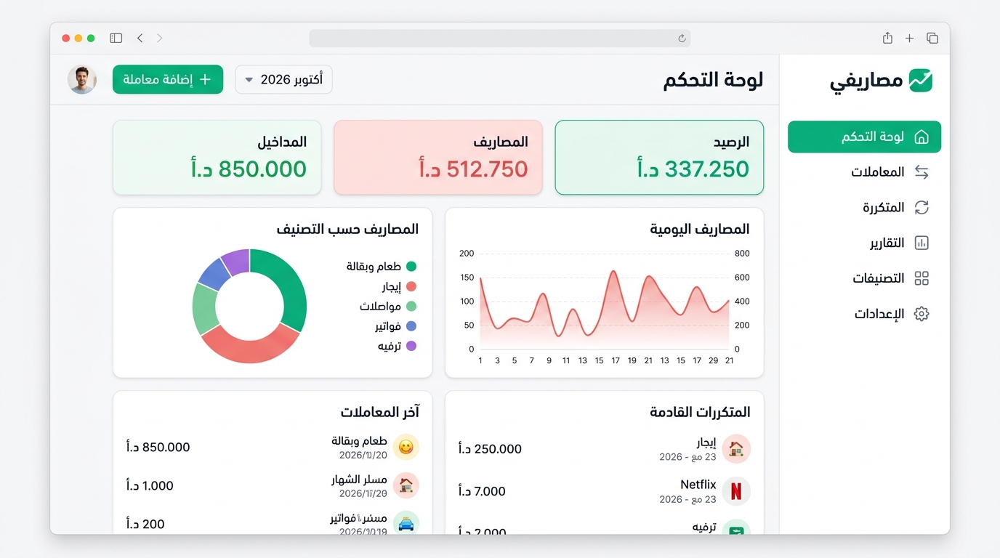
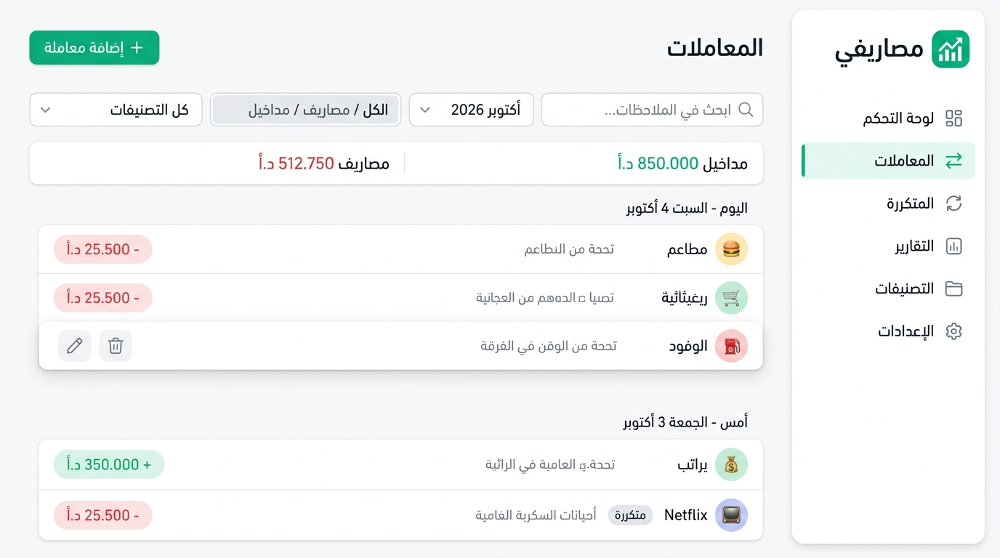
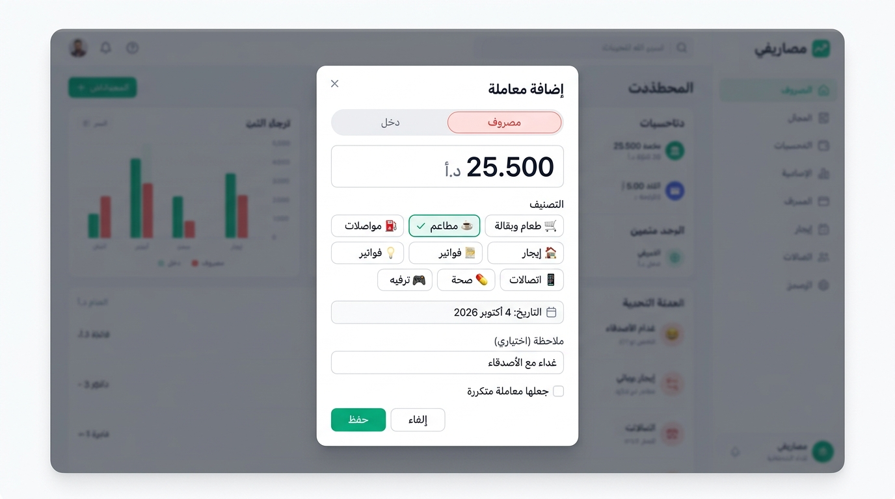
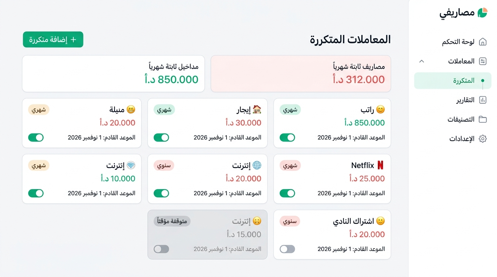
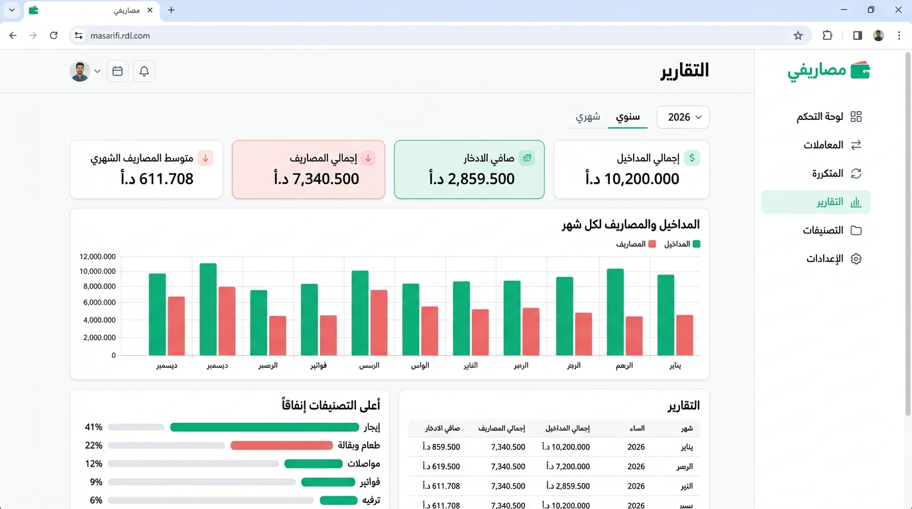
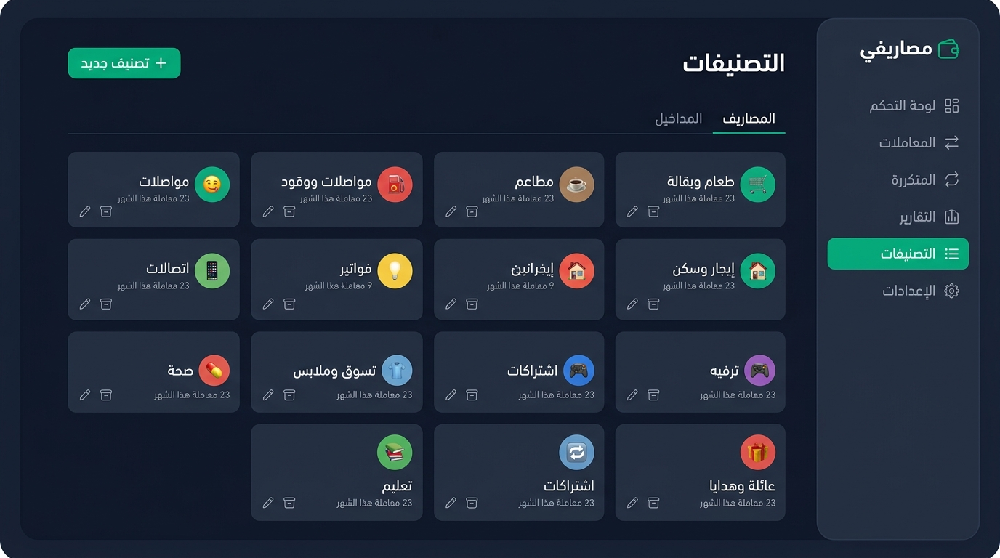
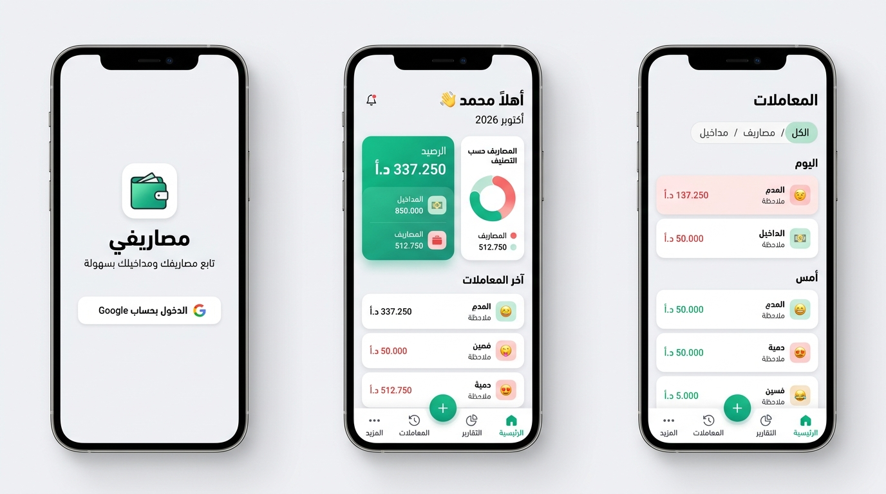

# تصميم واجهة «مصاريفي»

> [!NOTE]
> هاي صور تصميم مبدئية (mockups) عشان نتفق على **الشكل العام والتوزيع والألوان**. النصوص العربية داخل الصور فيها أخطاء لأن الصور مولّدة بالذكاء الاصطناعي، أما التطبيق الحقيقي فرح تكون نصوصه وأرقامه صحيحة.

## الهوية البصرية

| العنصر | القيمة |
|---|---|
| اللون الأساسي | أخضر زمردي `#10B981` |
| المصاريف | أحمر ناعم `#EF4444` |
| المداخيل | أخضر `#10B981` |
| الخلفية (فاتح) | رمادي فاتح جداً `#F8FAFC` مع بطاقات بيضاء |
| الخلفية (داكن) | `#0F172A` مع بطاقات `#1E293B` |
| الخط | Cairo |
| الزوايا | مدوّرة (12–16px) مع ظلال خفيفة |
| الاتجاه | من اليمين لليسار، والقائمة الجانبية على اليمين |

---

## شاشات الكمبيوتر

````carousel
### 1. لوحة التحكم

بطاقات الشهر الحالي، المصاريف حسب التصنيف، المصاريف اليومية، آخر المعاملات، والمتكررات القادمة.
<!-- slide -->
### 2. المعاملات

فلترة وبحث، ملخص للشهر، معاملات مجمّعة حسب اليوم، وأزرار تعديل وحذف بتظهر لما تمرّر الماوس فوق المعاملة.
<!-- slide -->
### 3. إضافة معاملة

نافذة سريعة: النوع، المبلغ بخط كبير، اختيار التصنيف بضغطة، التاريخ (اليوم بشكل افتراضي)، ملاحظة، وخيار تحويلها لمعاملة متكررة.
<!-- slide -->
### 4. المعاملات المتكررة

بطاقة لكل معاملة متكررة فيها المبلغ والتكرار والموعد القادم، مع مفتاح للتشغيل أو الإيقاف المؤقت.
<!-- slide -->
### 5. التقارير

تبويب شهري وتبويب سنوي، ورسم أعمدة لكل شهر، وأعلى التصنيفات إنفاقاً، وجدول تفصيلي.
<!-- slide -->
### 6. التصنيفات (الوضع الداكن)

إدارة التصنيفات بتبويبين للمصاريف والمداخيل. الوضع الداكن بيشتغل تلقائياً حسب إعدادات جهازك.
````

---

## شاشات التلفون



- **تسجيل الدخول:** زر واحد للدخول بحساب Google.
- **الرئيسية:** بطاقة الرصيد بارزة، وتحتها التوزيع وآخر المعاملات.
- **التنقل:** شريط سفلي (الرئيسية، المعاملات، التقارير، المزيد) مع زر **+** عائم بالنص لإضافة معاملة بسرعة. «المزيد» فيها المتكررة والتصنيفات والإعدادات.
- على التلفون، نافذة «إضافة معاملة» بتطلع من تحت الشاشة (bottom sheet) بدل ما تكون نافذة بالنص.

---

## صفحة الإعدادات (بدون صورة)
صفحة بسيطة فيها: صورة واسم الحساب، بداية الشهر المالي (من 1 لـ 28)، المظهر (تلقائي/فاتح/داكن)، وزر تسجيل الخروج.

