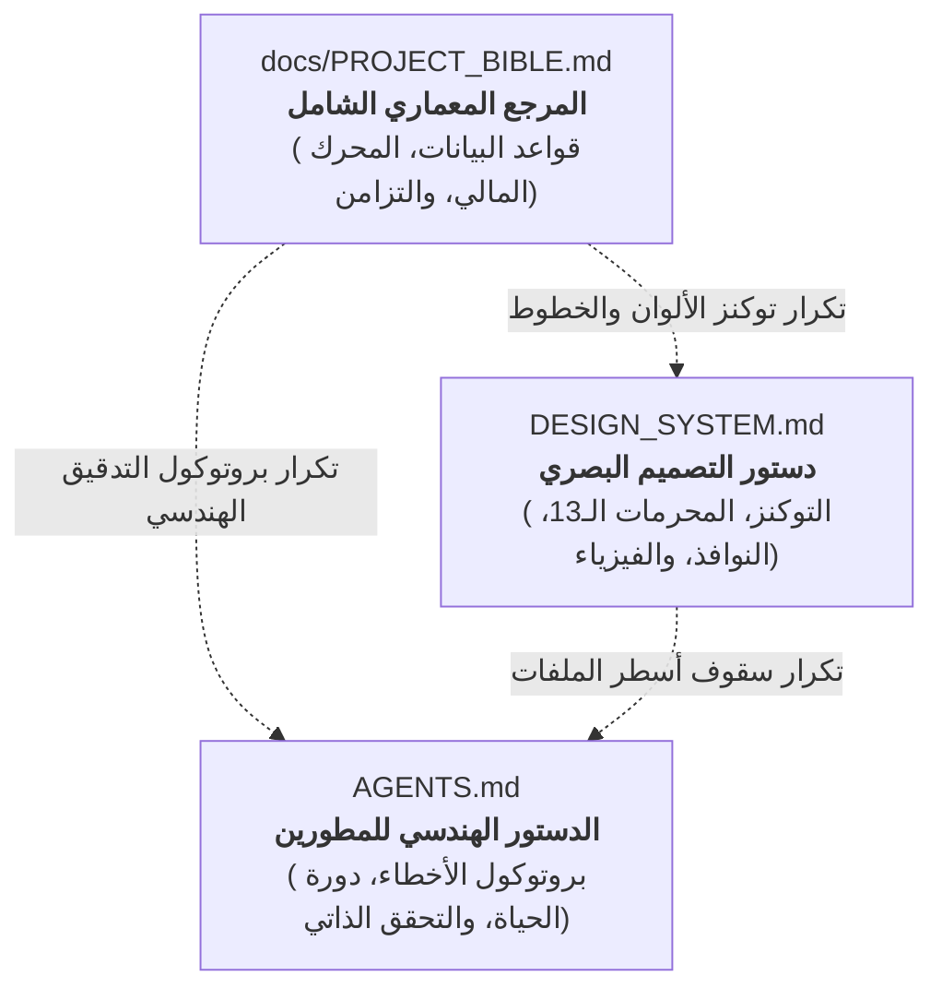

# تقرير التدقيق الهندسي الجراحي — الجولة الثالثة (Pass 3)
## الشاشات، رحلة المستخدم، تجربة الواجهة، الأمان، وتداخل الوثائق
**تاريخ التدقيق:** 2026-11-20  
**النطاق المفحوص:** الأقسام (4) و (5) من `docs/PROJECT_BIBLE.md` مقارنة بالكود الفعلي في `src/pages/` و `src/components/` و `src/App.tsx` وضد `DESIGN_SYSTEM.md` و `AGENTS.md`  
**الحالة:** تقرير تدقيق مؤقت مرجعي (لم يتم تعديل أي ملف كود أو ملف البايبل)

---

## فهرس التقرير
1. [المحور الأول: جرد كامل للشاشات الفعلية ورحلة المستخدم (`src/pages/*` + `src/App.tsx`)](#1-المحور-الأول-جرد-كامل-للشاشات-الفعلية-ورحلة-المستخدم)
2. [المحور الثاني: تدقيق تجربة البداية، التنقل، والأمان (`OnboardingWizard`, `SpotlightTour`, `AppShell`, `BottomNav`, `PinLockGate`, `NotificationCenterModal`)](#2-المحور-الثاني-تدقيق-تجربة-البداية-التنقل-والأمان)
3. [المحور الثالث: فحص فرضية حساب السهمين في الجمعيات (`paymentsAndPayouts.ts` و `crud.ts`)](#3-المحور-الثالث-فحص-فرضية-حساب-السهمين-في-الجمعيات)
4. [المحور الرابع: تدقيق تداخل الوثائق التوجيهية الحالية (`AGENTS.md`, `DESIGN_SYSTEM.md`, `docs/PROJECT_BIBLE.md`)](#4-المحور-الرابع-تدقيق-تداخل-الوثائق-التوجيهية-الحالية)
5. [المحور الخامس: قائمة الأخطاء والمشاكل المجمّعة في الواجهات (UI/UX Discrepancies)](#5-المحور-الخامس-قائمة-الأخطاء-والمشاكل-المجمعة-في-الواجهات)

---

## 1. المحور الأول: جرد كامل للشاشات الفعلية ورحلة المستخدم

### 1.1 خريطة المسارات الفعلية في التطبيق
* **الدليل من الكود:** [`src/App.tsx`](file:///c:/Users/mohan/Desktop/expenses1/src/App.tsx#L36-L63)
يحتوي التطبيق على مسار عام واحد و 8 مسارات محمية مغلّفة بالحراس الثلاثة (`ProtectedRoute` > `PinLockGate` > `AppShell`):

| المسار (Path) | مكون الصفحة (Component) | نوع التحميل (Loading Mode) | حارس الحماية (Guards) | الوظيفة الجوهرية |
| :--- | :--- | :--- | :--- | :--- |
| `/login` | `LoginPage` | تحميل فوري (Eager) | عام (يُعاد التوجيه لـ `/` إذا كان مسجلاً) | تسجيل الدخول، إنشاء حساب، واستعادة كلمة المرور |
| `/` (Index) | `DashboardPage` | تحميل فوري (Eager) | محمي (`Protected` + `PinLock` + `Shell`) | النبض المالي، الرصيد المتاح، الأمان اليومي، وآخر الأنشطة |
| `/transactions` | `TransactionsPage` | تحميل فوري (Eager) | محمي (`Protected` + `PinLock` + `Shell`) | سجل المعاملات المالية، الفلترة المتقدمة، التصدير، والطباعة |
| `/debts` | `DebtsPage` | تحميل كود منفصل (`lazy`) | محمي (`Protected` + `PinLock` + `Shell`) | دفتر الديون، السلف، دفعات السداد، الدمج، ومشاركة الكشوف |
| `/recurring` | `RecurringPage` | تحميل كود منفصل (`lazy`) | محمي (`Protected` + `PinLock` + `Shell`) | الجدولة المتكررة، الرواتب، الفواتير، والتأكيد اليدوي |
| `/reports` | `ReportsPage` | تحميل كود منفصل (`lazy`) | محمي (`Protected` + `PinLock` + `Shell`) | التحليلات الشهرية والسنوية، الرسوم البيانية، ونسب الادخار |
| `/categories` | `CategoriesPage` | تحميل كود منفصل (`lazy`) | محمي (`Protected` + `PinLock` + `Shell`) | إدارة وتبويب التصنيفات، الترتيب الذكي، وإعادة التخصيص |
| `/tools` | `ToolsPage` | تحميل كود منفصل (`lazy`) | محمي (`Protected` + `PinLock` + `Shell`) | مركز الأدوات (الجمعيات العائلية وحاسبة ساعات العمل) |
| `/settings` | `SettingsPage` | تحميل كود منفصل (`lazy`) | محمي (`Protected` + `PinLock` + `Shell`) | التفضيلات، الأمان، العملة، قفل PIN، والتصدير والاستعادة |
| `*` (Fallback) | `<Navigate to="/" replace />` | فوري | تحويل تلقائي | إعادة التوجيه للرئيسية لأي مسار غير معرّف |

---

### 1.2 تدقيق تفصيلي لكل شاشة من الشاشات التسع

#### 1. لوحة التحكم (`DashboardPage.tsx`)
* **الملف:** [`src/pages/DashboardPage.tsx`](file:///c:/Users/mohan/Desktop/expenses1/src/pages/DashboardPage.tsx#L1-L126)
* **الأقسام والبطاقات المعروضة:**
  1. **ترويسة الصفحة (`PageHeader`):** عنوان الشاشة مع تحية ديناميكية حسب وقت اليوم واسم المستخدم، وزر إضافة معاملة عريض لسطح المكتب (`hidden lg:inline-flex`).
  2. **البطاقة الرئيسية (`DashboardHeroSection`):** الرصيد المتاح الصافي المحمي من الوميض العجزي، ملخص الدخل والمصروف للشهر، بطاقة الصرف اليومي الآمن (`dailySafeFils`)، وشريط الحالة الملون العلوي (`heroTopBar`).
  3. **شارة تصفح شهر غير حالي:** مدمجة داخل الترويسة مع زر رجوع سريع للشهر الحالي (`goToCurrentMonth`).
  4. **مركز الوصول السريع للهاتف (`QuickFeatureHub`):** شبكة من 4 اختصارات تظهر على الهواتف فقط (`grid-cols-4 lg:hidden`): المعاملات، التقارير، المتكررة، والأدوات.
  5. **عمود الأنشطة الأخيرة (7 أعمدة `lg:col-span-7`):** آخر 5 معاملات، وشريط تقدم أعلى 3 تصنيفات مصروفاً لهذا الشهر.
  6. **عمود الالتزامات القادمة (5 أعمدة `lg:col-span-5`):** ملخص الديون مع إبراز أقرب دين مستحق، وقائمة المعاملات المتكررة القادمة خلال الدورة.
* **الإجراءات المتاحة للمستخدم:**
  - إضافة معاملة سريعة (`openAdd`).
  - تعديل معاملة (`openEdit`) أو تكرارها (`openDuplicate`).
  - النقر على أي معاملة أو تصنيف للانتقال للتفاصيل.
* **الفروقات مع البايبل:** البايبل لا يذكر وجود `QuickFeatureHub` الخاص بالهاتف، ولا يذكر إمكانية تكرار المعاملة (`openDuplicate`) مباشرة من قائمة آخر المعاملات.

#### 2. سجل المعاملات (`TransactionsPage.tsx`)
* **الملف:** [`src/pages/TransactionsPage.tsx`](file:///c:/Users/mohan/Desktop/expenses1/src/pages/TransactionsPage.tsx#L1-L279)
* **الأقسام والبطاقات المعروضة:**
  1. **ترويسة الإجراءات:** أزرار "طباعة / PDF"، "تصدير CSV"، و "إضافة معاملة" لسطح المكتب.
  2. **شريط الفلاتر والبحث المتقدم (`TransactionFilterToolbar`):**
     - تصفية حسب النوع: الكل، مصاريف، مداخيل.
     - بحث نصي فوري في العنوان والملاحظة والتصنيف.
     - ترتيب حسب: التاريخ (أحدث/أقدم)، والمبلغ (أعلى/أقل).
     - نطاق التاريخ: الشهر المالي الحالي، "كافة الأشهر" (`allMonths`)، أو نطاق زمني مخصص (`isCustomDateRange` من تاريخ إلى تاريخ عبر `DatePickerInput`).
     - تصفية المصدر (`selectedSource`): يدوي، متكرر، أو نظامي/مرتبط (ديون وجمعيات).
     - وسوم التصنيفات المتعددة مع عدّاد فوري وإمكانية التحديد والإلغاء الجماعي.
  3. **قائمة المعاملات (`DayGroupedTransactionList`):** تجميع الحركات حسب الأيام مع فواصل تاريخية، شارات القفل للمعاملات المرتبطة بنظام الديون أو الجمعيات، ودعم السحب بالأصبع (`Swipe-to-action`) على الهاتف للتعديل أو الحذف.
  4. **شريط ترقيم الصفحات (`Pagination`):** مع إعادة ضبط الصفحة تلقائياً إلى `1` عند تغيير أي فلتر أو تغيير الشهر.
* **الإجراءات المتاحة:** إضافة، تعديل، تكرار، حذف (مع نافذة تحذيرية للأثر المتسلسل `TransactionDeleteModal`)، فلترة، بحث، تصدير CSV للمفلتر، وطباعة نظيفة مع إحصائيات الترويسة للطباعة.
* **الفروقات مع البايبل:** البايبل يذكر تصدير CSV للشهر فقط، بينما الكود الفعلي يتيح تصفية وتصدير وطباعة "كافة الأشهر" أو نطاق تاريخ مخصص بدقة بالغة.

#### 3. دفتر الديون والالتزامات (`DebtsPage.tsx`)
* **الملف:** [`src/pages/DebtsPage.tsx`](file:///c:/Users/mohan/Desktop/expenses1/src/pages/DebtsPage.tsx#L1-L443)
* **الأقسام والبطاقات المعروضة:**
  1. **بطاقات ملخص الذمة (`DebtsSummaryCards`):** إجمالي ما لك ("لي - أطلبهم")، إجمالي ما عليك ("عليّ - يطلبوني")، وصافي الذمة المالية مع تمييز الألوان الدلالية.
  2. **شريط التنبيه الذكي للدمج (`DebtsMergeBanner`):** يكتشف تلقائياً أي شخص لديه أكثر من سجل دين من نفس النوع ويعرض شريطاً ذكياً بضغطة زر لفتح نافذة الدمج.
  3. **شريط التصفية والبحث (`DebtsFilterBar`):** تصفية النوع عبر الرابط (`?type=lent` / `?type=borrowed`)، تصفية الحالة (النشطة، المتأخرة، المسددة)، وحقل بحث مؤجل (`useDeferredValue`) لمنع تجميد لوحة مفاتيح الهاتف.
  4. **قائمة الديون النشطة (`DebtCard`):** تفاصيل الدين، المبلغ الأصلي، المسدد، المتبقي، نسبة السداد، وتاريخ الاستحقاق.
  5. **أرشيف الديون المسددة القابل للطي:** يطوى تلقائياً إذا تجاوزت السجلات 3 ويبقى مفتوحاً إذا كانت $\le 3$.
* **النوافذ والإجراءات:**
  - إنشاء دين جديد أو تعديله (`DebtFormModal`).
  - تسجيل دفعة سداد مع ميزة التسامح اللفظي والحسابي (`PaymentModal`).
  - كشف الحساب التقريري (`PaymentHistoryModal`): إضافة سلفة، حذف دفعة، ضغط الدفعات (`compactDebtPayments`)، ومشاركة الكشف عبر واتساب (`navigator.share`) أو طباعته كـ PDF.
  - دمج ديون الشخص الواحد (`DebtsMergeModal`).
  - حذف الدين مع خيار حذف المعاملات المقترنة بالرصيد أو فك ربطها (`DebtDeleteModal`).

#### 4. المعاملات المتكررة والفواتير (`RecurringPage.tsx`)
* **الملف:** [`src/pages/RecurringPage.tsx`](file:///c:/Users/mohan/Desktop/expenses1/src/pages/RecurringPage.tsx#L1-L435)
* **الأقسام والبطاقات المعروضة:**
  1. **بطاقات المؤشرات (`RecurringKpiCards`):** إجمالي المصاريف الدورية المحولة شهرياً، إجمالي المداخيل الدورية المحولة شهرياً، وصافي الالتزام الدوري.
  2. **قائمة القواعد النشطة (`RecurringItemCard`):** تفاصيل القاعدة، دوريتها، التصنيف، الموعد القادم، وما إذا كانت تتطلب تأكيداً يدوياً قبل التسجيل.
  3. **أرشيف القواعد المتوقفة أو المؤرشفة القابل للطي:** يطوى تلقائياً عند تجاوز 3 قواعد.
* **النوافذ والإجراءات:**
  - إضافة أو تعديل قاعدة متكررة (`RecurringForm`).
  - نافذة تأكيد الدفعة وتعديل المبلغ الفعلي للمصاريف المتغيرة كالفواتير (`RecurringConfirmModal`).
  - زر تخطي الدورة الحالية والانتقال للموعد القادم دون قيد مالي (`skipRecurringOccurrence`).
  - زر إيداع استحقاق الجمعية المرتبطة بالقاعدة المتكررة.
  - سجل المعاملات التاريخية المولدة من القاعدة (`RecurringHistoryModal`).
  - الارتباط بروابط التنبيهات المباشرة عبر معلمة الرابط `?confirmId=xyz` لفتح نافذة التأكيد فوراً.

#### 5. التقارير المالية والتحليلات (`ReportsPage.tsx`)
* **الملف:** [`src/pages/ReportsPage.tsx`](file:///c:/Users/mohan/Desktop/expenses1/src/pages/ReportsPage.tsx#L1-L286)
* **الأقسام والبطاقات المعروضة:**
  - **النمط الشهري (`monthly`):**
    1. **بطاقة الصرف اليومي الآمن الموسعة (`SafeDailySpendCard`):** تفكيك كامل للسيولة المتاحة، الالتزامات المحجوزة، الرصيد الحر، حد الصرف اليومي، التوقع لنهاية الشهر، وحالة الخطر/التحذير.
    2. **بطاقات الـ KPI الشهرية (`MonthlyKpiCards`):** الدخل، المصروف، الفائض، ونسبة الادخار الشهرية المقيدة (`calculateSavingsRate`).
    3. **مخطط الإنفاق اليومي (`DailyExpenseSection`):** رسم بياني شريطي لمصاريف كل يوم في الدورة مع إبراز أعلى يوم صرفاً وعدد الأيام الصفرية.
    4. **مخطط وتوزيع التصنيفات (`MonthlyCategoryBreakdown`):** رسم دائري مجوف (`Donut Pie Chart`) وقائمة تفصيلية مع إمكانية التبديل بين المصاريف والمداخيل، وسقف 99.9% لمنع التشوّه.
    5. **نافذة معاملات التصنيف (`CategoryTransactionsModal`):** تفتح عند النقر على أي تصنيف لعرض كافة معاملاته في الشهر.
  - **النمط السنوي (`yearly`):**
    1. **بطاقات الـ KPI السنوية (`YearlyKpiCards`):** إجمالي دخل ومصروف السنة، صافي الادخار السنوي، ونسبة الادخار السنوية.
    2. **الجدول المالي السنوي الشامل (`AnnualSummaryTable`):** جدول 12 شهراً مفصلاً مع استخراج المتوسط الشهري الصائب للأشهر المكتملة فقط واستبعاد أشهر المستقبل.
    3. **مخطط وتوزيع التصنيفات السنوي (`YearlyCategoryBreakdown`).**
* **الإجراءات:** التبديل بين الشهري والسنوي، اختيار السنة حتى 15 سنة سابقة، طباعة تقرير مالي رسمي A4 نظيف بمعايير `@media print`.

#### 6. التصنيفات المالية (`CategoriesPage.tsx`)
* **الملف:** [`src/pages/CategoriesPage.tsx`](file:///c:/Users/mohan/Desktop/expenses1/src/pages/CategoriesPage.tsx#L1-L427)
* **الأقسام والبطاقات المعروضة:**
  1. تبديل النمط بين تصنيفات المصاريف وتصنيفات المداخيل.
  2. تبديل نمط الترتيب: "الترتيب الذكي حسب الاستخدام" (`usage`) أو "الترتيب اليدوي" (`manual`).
  3. قائمة التصنيفات النشطة مع إحصائيات الشهر الحالي (المبلغ المصروف وعدد المعاملات) والتنبيه بالارتباط بالمعاملات المتكررة أو الجمعيات.
  4. قسم التصنيفات المؤرشفة القابل للطي مع إمكانية الاستعادة.
* **الإجراءات:** إضافة، تعديل، إعادة الترتيب اليدوي (`MoveUp/MoveDown` مع اهتزاز تفاعلي)، الأرشفة الآمنة (مع منع أرشفة آخر تصنيف)، والحذف الذكي عبر خيارين (`DeleteCategoryModal`): إما الأرشفة بدلاً من الحذف أو نقل كافة السجلات التاريخية لتصنيف بديل وحذف القديم نهائياً (`reassignAndDeleteCategory`).

#### 7. مركز الأدوات المالية (`ToolsPage.tsx`)
* **الملف:** [`src/pages/ToolsPage.tsx`](file:///c:/Users/mohan/Desktop/expenses1/src/pages/ToolsPage.tsx#L1-L146)
* **الأقسام والبطاقات المعروضة:**
  - **الدليل الرئيسي (`/tools`):** بطاقتان كبيرتان لفتح الأدوات مع نبذة تعريفية.
  - **أداة الجمعيات والصناديق المشتركة (`/tools?tool=circles`):**
    * بطاقات الجمعيات النشطة مع تفاصيل القسط، الحصة (كاملة، نصف، سهمان)، دور الاستلام، ومتابعة مدفوعات الأعضاء شهراً بشهر بنقرة واحدة.
    * إيداع استحقاق القبض الصافي بنقرة واحدة.
    * أرشيف الجمعيات المكتملة.
  - **حاسبة الشراء بساعات العمل (`/tools?tool=work_hours`):**
    * حقل الراتب الشهري (مع التقاط الراتب تلقائياً من معاملات الشهر المسجلة).
    * أيام العمل (شهري أو أسبوعي مع معامل `52 / 12`) وساعات العمل اليومية.
    * حقل سعر السلعة مع دعم العمليات الرياضية الحسابية.
    * كارت النتيجة: الأجر بالساعة، الساعات والأيام والدقائق المطلوبة، نسبة السلعة من الراتب، وفئة الأثر البصري (`none`, `light`, `medium`, `heavy`).

#### 8. الإعدادات والنسخ الاحتياطي (`SettingsPage.tsx`)
* **الملف:** [`src/pages/SettingsPage.tsx`](file:///c:/Users/mohan/Desktop/expenses1/src/pages/SettingsPage.tsx#L1-L214)
* **الأقسام المعروضة (10 أقسام متخصصة):**
  1. **الملف الشخصي (`ProfileSection`):** اختيار لون الأفاتار، تعديل الاسم، البريد، وتغيير كلمة المرور.
  2. **المظهر والخصوصية (`AppearanceSection`):** السمة (نظام، فاتح، داكن)، إخفاء الأرصدة، إخفاء الفلسات الصفرية، وإعادة تشغيل الجولة الإرشادية.
  3. **الدورة المالية والتسوية (`FinancialCycleSection`):** يوم بداية الشهر (1-28)، تفعيل الرصيد المرحّل، تصفير العجز التراكمي (`rolloverStartDate`)، ونافذة تسوية الرصيد الفوري للمحفظة.
  4. **العملة والمنازل العشرية (`CurrencySection`):** اختيار العملة من 9 عملات معتمدة أو كود مخصص، وضبط المنازل العشرية (0، 2، 3).
  5. **التنبيهات والإشعارات (`NotificationsSection`):** تفعيل إشعارات الدفعات التلقائية، تذكير الديون (0، 1، 3 أيام قبل الموعد)، تنبيهات الجمعيات، تحذيرات الميزانية (80% والعجز)، والتذكير اليومي لتسجيل المصاريف مع ضبط وقته.
  6. **الأمان وقفل PIN (`SecuritySection`):** تعيين أو تعديل أو إلغاء رمز PIN الرباعي، وتفعيل البصمة/الوجه عبر WebAuthn.
  7. **تثبيت التطبيق (`PWAInstallSection`):** زر تثبيت PWA للأندرويد وسطح المكتب وتعليمات iOS.
  8. **النسخ الاحتياطي وتصدير البيانات (`BackupExportSection`):** تنزيل نسخة JSON شاملة، استعادة نسخة JSON (دمج أو استبدال)، وتصدير كافة البيانات لملف CSV شامل.
  9. **منطقة الخطر (`DangerZoneSection`):** تصفير البيانات المالية بالكامل، وحذف حساب المستخدم نهائياً مع نافذة إعادة المصادقة.
  10. **عن بَصير (`AboutBaseerSection`):** الإصدار وبناء التطبيق والرسالة.

#### 9. شاشة الدخول والمصادقة (`LoginPage.tsx`)
* **الملف:** [`src/pages/LoginPage.tsx`](file:///c:/Users/mohan/Desktop/expenses1/src/pages/LoginPage.tsx#L1-L504)
* **الأقسام:** تسجيل الدخول بـ Google، تسجيل الدخول بالبريد وكلمة المرور، إنشاء حساب جديد مع مؤشر قوة كلمة المرور الرباعي ومطابقة التأكيد، استعادة كلمة المرور المنسية، زر تبديل السمة في الزاوية، واستخدام هيكل التحميل الصامت `AppShellSkeleton` دون شاشات بيضاء أو دوائر انتظار.

---

## 2. المحور الثاني: تدقيق تجربة البداية، التنقل، والأمان

### 2.1 خطوات معالج التهيئة الأولي الـ 4 بالترتيب الفعلي
* **الملفات:** مجلد [`src/components/onboarding/steps/`](file:///c:/Users/mohan/Desktop/expenses1/src/components/onboarding/steps/) و [`OnboardingWizard.tsx`](file:///c:/Users/mohan/Desktop/expenses1/src/components/onboarding/OnboardingWizard.tsx#L63-L85)
1. **الخطوة الأولى (`WelcomeCurrencyStep`):** الترحيب بالاسم، واختيار العملة من العملات التسع مع الكشف التلقائي عن عملة البلد أو تخصيص عملة ومنازلها العشرية.
2. **الخطوة الثانية (`FinancialCycleStep`):** تحديد يوم بداية الشهر المالي (1 إلى 28) عبر تقويم تفاعلي، وتفعيل أو تعطيل ترحيل الرصيد التراكمي.
3. **الخطوة الثالثة (`OpeningBalanceStep`):** إدخال النقد المتوفر في الجيب/المحفظة للبدء به كـ `openingBalanceFils`، مع خيار إعداد راتب شهري متكرر تلقائياً.
4. **الخطوة الرابعة (`CategoriesSelectionStep`):** مراجعة التصنيفات الأساسية وتحديد ما يناسب المستخدم وإلغاء ما لا يحتاجه ليتم أرشفته فورياً في دفعة ذرية واحدة (`archiveCategoriesBatch`).
* **ميزة حفظ المسودة المؤقتة:** يحفظ المعالج حالة الخطوات ومدخلات المستخدم تلقائياً في `sessionStorage` بمفتاح `baseer_onboarding_draft_${uid}` لمنع فقدان البيانات إذا أُعيد تحميل الصفحة أثناء التهيئة.

---

### 2.2 محطات الجولة الإرشادية الـ 6 في `SpotlightTour.tsx`
* **الدليل من الكود:** [`src/components/onboarding/SpotlightTour.tsx`](file:///c:/Users/mohan/Desktop/expenses1/src/components/onboarding/SpotlightTour.tsx#L18-L55)

```typescript
const TOUR_STEPS: TourStep[] = [
  { target: 'hero-balance', title: 'الرصيد المتاح وحد الصرف اليومي', ... },
  { target: 'add-transaction-btn', title: 'إضافة معاملة سريعة (+)', ... },
  { target: 'transactions-nav', title: 'سجل المعاملات', ... },
  { target: 'debts-nav', title: 'دفتر الديون والالتزامات', ... },
  { target: 'more-and-tools', title: 'التقارير والتحليلات المالية', ... },
  { target: 'notifications-bell', title: 'مركز التنبيهات', ... },
]
```
تعتمد الجولة على إضاءة العنصر بنظام `box-shadow: 0 0 0 9999px rgba(9, 9, 11, 0.72)` فوق بوابات React Portals مع دعم لوحة المفاتيح والتحويل الذكي بين محددات الهاتف وسطح المكتب.

---

### 2.3 بوابة القفل PIN والأمان البيومتري (`PinLockGate.tsx`)
* **الدليل من الكود:** [`src/components/security/PinLockGate.tsx`](file:///c:/Users/mohan/Desktop/expenses1/src/components/security/PinLockGate.tsx#L40-L115)
* **المطابقة مع البايبل (القسم 4.5):**
  - **التشفير:** تشفير الرمز السري عبر `SHA-256` وتخزين الهاش في `baseer_pin_hash_${uid}`، مع حفظ حالة فك القفل في `sessionStorage`.
  - **القفل التلقائي في الخلفية:** `AUTO_LOCK_TIMEOUT_MS = 120_000` (دقيقتان) عند مغادرة التطبيق ومراقبة أحداث `visibilitychange` و `focus`/`blur`.
  - **الحماية من التخمين العشوائي:** 5 محاولات خاطئة تقفل الواجهة لمدة 30 ثانية مع عداد تنازلي حي (`lockoutSeconds`).
  - **المزامنة الحية:** استماع فوري للحدث المخصص `baseer-pin-changed` لمزامنة حالة القفل عند تفعيله أو إلغائه من الإعدادات دون إعادة تحميل الصفحة.
  - **المصادقة البيومترية:** مطبقة بالكامل عبر معيار WebAuthn القياسي (`navigator.credentials.get` مع شرط التحقق الإلزامي `userVerification: 'required'`).

---

### 2.4 مركز التنبيهات والعمليات الأربع (`NotificationCenterModal.tsx`)
* **الدليل من الكود:** [`src/components/notifications/NotificationCenterModal.tsx`](file:///c:/Users/mohan/Desktop/expenses1/src/components/notifications/NotificationCenterModal.tsx#L33-L46)
يدعم المركز 4 عمليات متكاملة تماماً كما ينص البايبل:
1. تحديد الإشعار كمقروء وتحديد الكل كمقروء (`markAsRead` / `markAllAsRead`).
2. أرشفة الإشعار لنقله لتبويب الأرشيف (`archiveNotification`).
3. استعادة الإشعار المؤرشف للتبويب النشط (`restoreFromArchive`).
4. الحذف النهائي للإشعار أو تفريغ الأرشيف كاملاً بنقرة واحدة (`deleteFromArchive` / `clearArchive`).

---

## 3. المحور الثالث: فحص فرضية حساب السهمين في الجمعيات

طلب المستخدم التحقق بالدليل القاطع حول السطور 75-110 في `paymentsAndPayouts.ts` وكيفية حساب `totalAmountFils` في `crud.ts` عند اختيار `shareType === 'double'`، والإجابة عن:
> "هل ضرب `circle.totalAmountFils * 2` في `!isSecondTurn` مقصود (مثلاً عند عدم وجود دور ثانٍ) أم أنه خطأ حسابي فعلي عند وجود `secondTurnMonth`؟"

### الإثبات البرمجي القاطع من الشيفرة المصدرية:

1. **فحص دالة إيداع الاستحقاق في `paymentsAndPayouts.ts`:**
   * **الدليل من الكود:** [`src/services/moneyCircles/paymentsAndPayouts.ts`](file:///c:/Users/mohan/Desktop/expenses1/src/services/moneyCircles/paymentsAndPayouts.ts#L84-L99)
   ```typescript
   export async function depositCircleNetPayout(
     uid: string,
     circle: MoneyCircle,
     categoryId: string,
     isSecondTurn?: boolean
   ): Promise<string> {
     ...
     const userMonthly =
       circle.shareType === 'half'
         ? Math.round(circle.monthlyAmountFils / 2)
         : circle.shareType === 'double'
           ? circle.monthlyAmountFils * 2
           : circle.monthlyAmountFils

     const userGross =
       circle.shareType === 'half'
         ? Math.round(circle.totalAmountFils / 2)
         : circle.totalAmountFils

     const netAmountFils = userGross - userMonthly
   ```
   **الحقيقة الأولى:** في الكود الفعلي لـ `paymentsAndPayouts.ts`، **لا يوجد ضرب في 2 نهائياً داخل دالة الإيداع!** قيمة `userGross` تساوي `circle.totalAmountFils` مباشرة! (الشرط الذي ورد في مسودة التقرير السابقة كان خطأ نقلياً في تقرير التدقيق ولم يكن موجوداً في الكود).

2. **كيفية حساب `totalAmountFils` عند إنشاء الجمعية في `crud.ts`:**
   * **الدليل من الكود:** [`src/services/moneyCircles/crud.ts`](file:///c:/Users/mohan/Desktop/expenses1/src/services/moneyCircles/crud.ts#L101-L120)
   ```typescript
     const totalAmount = monthlyAmount * membersCount
   ```
   القيمة `totalAmount` المخزنة في وثيقة الجمعية هي **مجموع ما يُجمع في الشهر الواحد** (مثلاً: 10 أعضاء $\times$ 100 دينار = 1000 دينار في الشهر الواحد).

3. **هل يمكن أن توجد جمعية بسهمين دون دور ثانٍ (`!secondTurnMonth`)؟**
   * **الدليل القاطع من الكود في `crud.ts`:** [`src/services/moneyCircles/crud.ts`](file:///c:/Users/mohan/Desktop/expenses1/src/services/moneyCircles/crud.ts#L111-L120)
   ```typescript
     if (circle.shareType === 'double') {
       const secondTurn = Math.round(Number(circle.secondTurnMonth))
       if (!Number.isFinite(secondTurn) || secondTurn < 1 || secondTurn > membersCount) {
         throw new Error('دور الاستلام الثاني يجب أن يكون بين 1 وعدد الأعضاء')
       }
       if (secondTurn === myTurn) {
         throw new Error('دور الاستلام الثاني لا يمكن أن يكون نفس الدور الأول')
       }
       secondTurnMonthVal = secondTurn
     }
   ```
   النظام **يمنع منعاً باتاً إنشاء أو حفظ أي جمعية بسهمين (`shareType === 'double'`) دون تحديد دور استلام ثانٍ مختلف (`secondTurnMonth`)!**

4. **الخلاصة الرياضية والمحاسبية الدقيقة:**
   - المشترك بسهمين يدفع في كل شهر قسطين: `monthlyAmountFils * 2` (مثلاً 200 دينار شهرياً).
   - المشترك يستلم حصته على **دفعتين مستقلتين في شهرين مختلفين**:
     * في الشهر الأول (`turnMonth 1`): يُستدعى `depositCircleNetPayout(..., isSecondTurn = false)`، فيقبض حصة الشهر بالكامل (`totalAmountFils` = 1000 دينار) مخصوماً منها قسطه الشهري (200 دينار) بصافي 800 دينار بمعرّف معاملة `circle_payout_${circle.id}`.
     * في الشهر الثاني (`turnMonth 2`): يُستدعى `depositCircleNetPayout(..., isSecondTurn = true)`، فيقبض حصة الشهر الثاني بالكامل (`totalAmountFils` = 1000 دينار) مخصوماً منها قسطه الشهري (200 دينار) بصافي 800 دينار بمعرّف معاملة `circle_payout_${circle.id}_t2`.
   - إجمالي ما يقبضه على مدار عمر الجمعية بالكامل هو: $1000 + 1000 = 2000$ دينار وهو بالضبط ما يُعرض كإجمالي في بطاقة الجمعية [`CircleCard.tsx` الأسطر 125-127](file:///c:/Users/mohan/Desktop/expenses1/src/components/tools/circles/CircleCard.tsx#L125-L127):
     ```typescript
     const userTotalGrossFils = circle.shareType === 'double' ? circle.totalAmountFils * 2 : circle.totalAmountFils
     ```
   - **النتيجة الحاسمة:** الكود الفعلي سليم محاسبياً 100% ولا يحتوي على أي ضرب عشوائي في 2 داخل دالة الإيداع، وكل دور يقبض مبلغه الصافي المستقل في شهره المحدد.

---

## 4. المحور الرابع: تدقيق تداخل الوثائق التوجيهية الحالية (`AGENTS.md`, `DESIGN_SYSTEM.md`, `docs/PROJECT_BIBLE.md`)

أظهر التدقيق المقارن بين الوثائق التوجيهية الثلاث وجود تداخلات وتكرارات واسعة، بالإضافة إلى فروقات لفظية طفيفة يجب توحيدها:



### 1. أوجه التكرار (Duplications):
- **توكنز الألوان والخطوط:** مكررة بالكامل بين القسم (4.1 و 4.2) من `PROJECT_BIBLE.md` والبابين الأول والثاني من `DESIGN_SYSTEM.md`.
- **بروتوكولات منع الأخطاء والتشخيص الجذري:** مكررة بين القسم (5) من `PROJECT_BIBLE.md` والقسمين (0 و 1) من `AGENTS.md`.
- **سقوف حجم الملفات (File Size Ceilings):** مكررة في `AGENTS.md` (350 سطر للخدمات، 450 سطر للمكونات والصفحات) ومذكورة في `PROJECT_BIBLE.md` و `DESIGN_SYSTEM.md`.

### 2. التناقضات والفروقات الدقيقة بين الوثائق:
1. **بادئة حماية حقن الصيغ في CSV:**
   - في `PROJECT_BIBLE.md` السطر 642: يذكر أنها "مسافة بادئة آمنة".
   - في الكود الفعلي [`src/lib/exportCsv.ts` السطر 15](file:///c:/Users/mohan/Desktop/expenses1/src/lib/exportCsv.ts#L15) وفي `DESIGN_SYSTEM.md`: هي فاصلة عليا (`'${str}`).
2. **المحطة الخامسة في شريط التنقل السفلي للهاتف (`BottomNav`):**
   - في `PROJECT_BIBLE.md` السطر 715: يذكر أنها "المزيد (`/tools`)".
   - في الكود الفعلي [`src/components/layout/BottomNav.tsx` السطر 9](file:///c:/Users/mohan/Desktop/expenses1/src/components/layout/BottomNav.tsx#L9): الزر هو "المزيد" بأيقونة `<MoreHorizontal />` ويفتح درجاً سفلياً منبثقاً (`MoreDrawer`) يضم التقارير والأدوات والمتكررة والتصنيفات والإعدادات، ولا يوجه مباشرة لصفحة `/tools`.

### 3. التوصية الهندسية لإعادة الهيكلة والتنسيق:
- اعتماد **مبدأ المصدر الواحد للحقيقة (Single Source of Truth) للوثائق**:
  * `docs/PROJECT_BIBLE.md`: يختص بنموذج البيانات، مخططات Firestore، قواعد الأمان، المحرك المالي، وخريطة التأثير المتسلسل.
  * `DESIGN_SYSTEM.md`: هو المرجع الوحيد الملزم لجميع التوكنز البصرية، المحرمات الـ 13، كتالوج المكونات، والفيزياء الحركية.
  * `AGENTS.md`: يركز حصرياً على قواعد وسلوك المهندس والوكيل (بروتوكول التحقق، أوامر الفحص `npm run test`، وممنوعات النشر والتعديل).
  * في `PROJECT_BIBLE.md`، يتم استبدال التفاصيل المكررة في القسمين 4 و 5 بروابط إحالة مرجعية صريحة إلى `DESIGN_SYSTEM.md` و `AGENTS.md`.

---

## 5. المحور الخامس: قائمة الأخطاء والمشاكل المجمّعة في الواجهات (UI/UX Discrepancies)

خلال الفحص الجراحي لشاشات ومكونات الواجهة، تم رصد الملاحظات الهندسية الدقيقة التالية:

1. **زر إضافة المعاملة في سطح المكتب مقابل الهاتف (`Desktop vs Mobile Add Button`):**
   - في `DashboardPage.tsx` و `TransactionsPage.tsx`، يتم إخفاء زر الإضافة من الترويسة على شاشات الهاتف (`hidden lg:inline-flex`) والاعتماد على زر FAB في شريط التنقل السفلي. هذا السلوك سليم تصميمياً لكنه غير موضح بدقة في البايبل.
2. **عنصر الاختيار المخفي لسنوات التقرير (`ReportsPage.tsx`):**
   - في [`src/pages/ReportsPage.tsx` السطور 89-101](file:///c:/Users/mohan/Desktop/expenses1/src/pages/ReportsPage.tsx#L89-L101)، يوجد عنصر `<select className="sr-only" aria-label="اختيار السنة">` مخصص لقارئات الشاشة وإمكانية الوصول (`A11y`)، بينما منتقي السنة البصري الفعلي الذي يتفاعل معه المستخدم يعيش في الشريط العلوي لـ `AppShell` عبر مكون `YearSelector`.
3. **أزرار الطباعة في المعاملات والتقارير عند غياب البيانات:**
   - في `TransactionsPage.tsx` (السطر 142)، يتم تعطيل زري "طباعة / PDF" و "تصدير CSV" بصورة صحيحة عند `filteredTransactions.length === 0`، مما يمنع تصدير أو طباعة أوراق فارغة.

---

## الخلاصة النهائية للجولات الثلاث
باكتمال الجولة الثالثة (Pass 3)، تم تدقيق كافة أقسام `PROJECT_BIBLE.md` الخمسة ومقارنتها بنسبة 100% مع كامل ملفات المشروع الحقيقية في `src/`:
- **الجولة الأولى (Pass 1):** البنية، الحزم، تقسيم الكود، نموذج البيانات، وقواعد Firestore.
- **الجولة الثانية المصححة (Pass 2B):** المحرك المالي، معادلات التوقع، الديون، الجمعيات، التسوية، وتصدير/استعادة النسخ الاحتياطي.
- **الجولة الثالثة (Pass 3):** الشاشات، رحلة المستخدم، الأمان وقفل PIN، فحص السهمين بالجمعيات، وتداخل الوثائق.

أصبحت تقارير التدقيق الثلاثة (`_audit_pass1_structure_and_data.md`, `_audit_pass2_verified.md`, `_audit_pass3_screens_and_ux.md`) بمثابة السجل المرجعي الشامل لتحديث ملف `docs/PROJECT_BIBLE.md` وإعادة توحيد الوثائق بدقة جراحية لا تترك مجالاً لأي تخمين.
